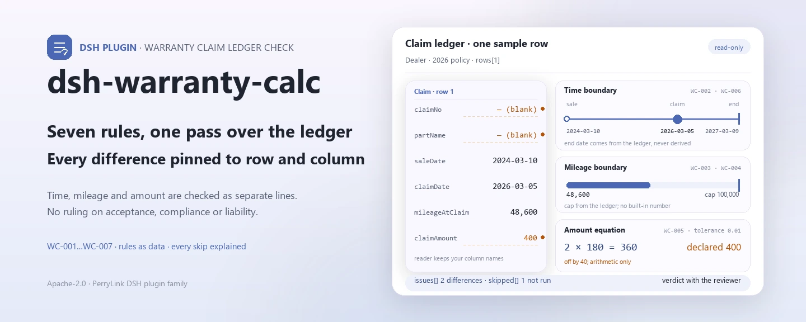
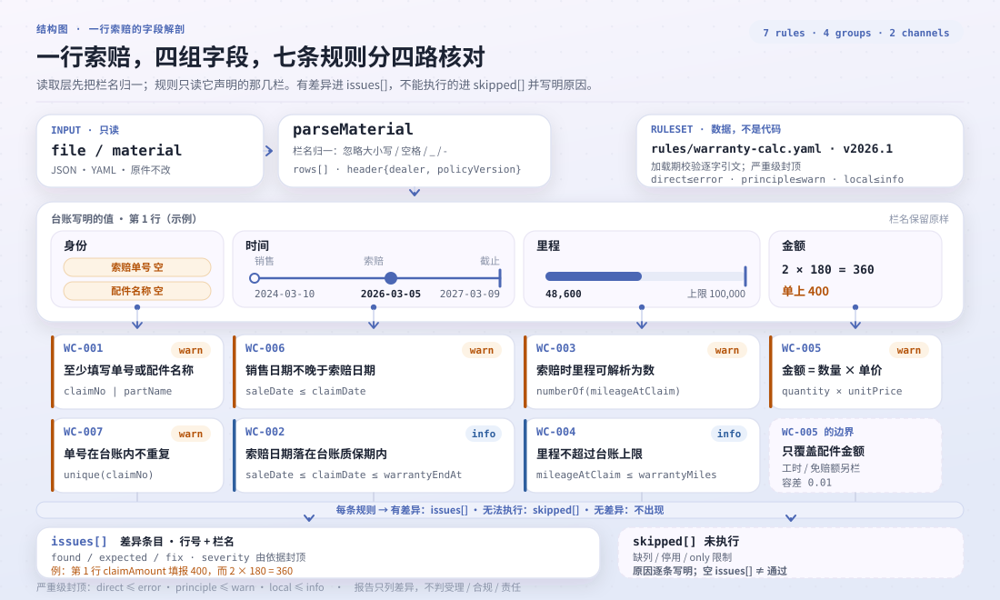

<div align="center">

<picture>
  <source media="(prefers-color-scheme: dark)" srcset="docs/assets/dsh-warranty-calc-hero-en-dark.webp">
  
</picture>

# dsh-warranty-calc

**Point out, claim by claim, every arithmetic and period inconsistency in a warranty claim register — which row, which column, what differs.**

A host-side checker for contract management and warranty settlement: no command line required, the original is never modified, no network request, no model call. Excel can be converted to JSON/YAML first — in chat too, where the platform supports it.

[Install](#three-step-setup) · [Configuration](#configuration) · [FAQ](#faq) · [简体中文](README.md) · [English](README.en.md) · [Español](README.es.md) · [Português](README.pt.md) · [हिन्दी](README.hi.md)

[](LICENSE)
[](#compatibility)
[](https://www.npmjs.com/package/dsh-warranty-calc)
[](https://github.com/PerryLink/dsh-warranty-calc/actions/workflows/ci.yml)
[](#compatibility)

[](https://github.com/PerryLink/dsh-warranty-calc/stargazers)
[](https://www.npmjs.com/package/dsh-warranty-calc)
[](https://dshfind.com/plugins/PerryLink/dsh-warranty-calc?ref=badge)
[](https://securityscorecards.dev/viewer/?uri=github.com/PerryLink/dsh-warranty-calc)
[](https://dsh.market/)
[](https://gitee.com/perrylink/dsh-warranty-calc)

```sh
dsh plugin --profile <name> add dsh-warranty-calc
```

</div>

<sub>Community plugin, not affiliated with DeepSeek. Canonical repository: <https://github.com/PerryLink/dsh-warranty-calc> (Gitee is a mirror).</sub>

## What it is

`dsh-warranty-calc` reads one warranty claim register — the dealer header plus one row per claim — and checks that register's own arithmetic and period self-consistency: that each claim records its claim number or part name, that the claim date falls inside the warranty end date the register states, that the mileage at claim parses as a number and does not exceed the mileage cap the register states, that the claim amount equals quantity × unit price, that the sale date does not follow the claim date, and that claim numbers do not repeat.

It returns only the differences it can point to inside the material, with a locator (row, column), the expectation, and the fix; it does not decide whether a claim should be accepted or whether a failure is covered, it issues no compliance or liability verdict, and it does not replace the reviewer. Pure host-side, zero dependencies, no network, no model call; the original is read-only.

<picture>
  <source media="(prefers-color-scheme: dark)" srcset="docs/assets/dsh-warranty-calc-flow-v5-dark.svg">
  
</picture>

## Three-step setup

1. **Install** (published on npm):

   ```sh
   dsh plugin --profile <name> add dsh-warranty-calc
   ```

2. **Confirm it mounts**:

   ```sh
   dsh --profile <name> --dump-config | grep 'dsh-warranty-calc'
   ```

3. **Run once**: hand the register (JSON/YAML) to the `warranty_calc` tool through `file` or `material`. Minimal input:

   ```json
   {"rows":[{"quantity":"2","unitPrice":"180","claimAmount":"400"}]}
   ```

   The first finding, `WC-005`, states that row 1 reports 400 for `claimAmount` while 2 × 180 = 360.

**Uninstall**: `dsh plugin --profile <name> remove dsh-warranty-calc` (or remove the row from the profile patch).

The repository ships a re-runnable quickstart (the script imports `lib/index.mjs`, so build first):

```sh
pnpm run build
node samples/quickstart/run.mjs
```

The sample lives in `samples/quickstart/input/`, the expected summary in `samples/quickstart/expected/result.json`, and a terminal screenshot at `docs/assets/quickstart.png`.

You can also skip the plugin install: search for “Tender Compliance Suite” in WorkBuddy / Coze (this check is one part of it; availability as listed).

## Core capabilities

The tool is registered as `warranty_calc`: it reads one claim register, applies a versioned rule pack, and returns a report.

- **Seven rules in one run** — `WC-001`–`WC-007` cover minimum tracing information, the date window inside the warranty period, mileage parseability, the mileage cap, the parts arithmetic, sale/claim date order, and duplicate claim numbers; the rule pack is versioned in `rules/warranty-calc.yaml`.
- **Every finding lands on a row and a column** — the report carries `ruleId`, `severity`, `locator.row` / `locator.field`, `found`, `expected`, and `fix`; it lists differences and makes no verdict.
- **Failure is never silent** — every check that cannot run enters `skipped` with its reason; a rule whose required column is missing reports itself instead of passing.
- **Rules are data** — replacing `rules/*.yaml` switches the rule set without touching TypeScript; load-time guards check citation completeness and severity ceilings.
- **Pure host-side, zero dependencies** — no network, no model call, no native code; a single call reads only the material you pass.
- **Concurrency-safe** — the tool declares `isConcurrencySafe`, so a batch of registers can run in parallel without shared session state.

| Rule | Check | Severity | Basis kind |
|---|---|---|---|
| `WC-001` | the claim records its number or part name | warn | direct |
| `WC-002` | the claim date falls inside the recorded warranty end | info | local |
| `WC-003` | mileage at claim parses as a number | warn | principle |
| `WC-004` | mileage at claim does not exceed the recorded cap | info | local |
| `WC-005` | the claim amount equals quantity × unit price | warn | direct |
| `WC-006` | the sale date does not follow the claim date | warn | principle |
| `WC-007` | claim numbers do not repeat | warn | principle |

Basis kinds: `direct` = the clause states the requirement directly; `principle` = inferred from a principle clause (`derived-from-principle`, severity capped at `warn`); `local` = an institutional configuration (`institutional-configuration`, capped at `info`).

### Examples

The detailed output below is the plugin's real output on the `WC-005` fixture — not a mock-up.

**Tool** `warranty_calc`

**Input**

```json
{"rows":[{"数量":"2","单价":"180","索赔金额":"400"}]}
```

**Output**

```json
{
  "id": "dsh-warranty-calc.WC-005.41a857ae",
  "ruleId": "WC-005",
  "severity": "warn",
  "locator": {
    "column": "claimAmount",
    "row": 1
  },
  "found": "第 1 行「claimAmount」填报 400，而 2 × 180 = 360",
  "expected": "「claimAmount」应等于 quantity × unitPrice",
  "fix": "核对是否抄错或漏改；本条只做算术核对，不判断各因子是否正确",
  "basis": "《家用汽车产品修理更换退货责任规定》（市场监管总局令第43号（2021 年 7 月 22 日公布，自 2022 年 1 月 1 日起施行）） 第十九条（免费修理，包括免除工时费和材料费）：「家用汽车产品在包修期内出现质量问题或者易损耗零部件在其质量保证期内出现质量问题的，消费者可以凭三包凭证选择修理者免费修理（包括免除工时费和材料费）。」"
}
```

*Observed from `dsh-warranty-calc/tests/fixtures/WC-005/WC-005-unsafe.json`*

Another real sample comes from the quickstart:

```text
$ node samples/quickstart/run.mjs
warranty_calc: 1 issue(s) — error 0, warn 1, info 0
skipped: 1
```

*Observed from `samples/quickstart/expected/result.json`*

## Standards it follows

| Document | Number | Cited by rules |
|---|---|---|
| Provisions on the Liability for Repair, Replacement and Return of Household Automobile Products | SAMR Order No. 43 (promulgated 22 July 2021, effective 1 January 2022) | WC-001, WC-003, WC-005, WC-006, WC-007 |
| Manufacturer warranty policies and three-guarantee rules (institutional configuration) | No unified standard (this rule relies on the warranty period recorded in the register) | WC-002 |
| Manufacturer warranty policies (institutional configuration) | No unified standard (this rule relies on the mileage cap recorded in the register) | WC-004 |

**Boundary:** this plugin checks a **warranty claim register** for arithmetic and period self-consistency — that a claim records its number or part name, that the claim date falls inside the warranty end date the register states, that mileage parses and does not exceed the mileage cap the register states, that the claim amount equals quantity × unit price, that the sale date does not follow the claim date, and that claim numbers do not repeat. It does **not** decide whether a claim should be accepted, whether a failure is covered, or whether it was caused by misuse or normal wear.

> ### ⚠️ Warranty policy is the manufacturer's, and this pack does not pretend to quote one
>
> Period length, mileage cap, labour rates and deductibles are set by **each manufacturer's warranty policy** and by the three-guarantee rules for the relevant product category. **No unified standard exists**, so every rule's `basis` says exactly that and stays at `warn` or `info`.
>
> Three consequences are worth knowing before trusting a finding:
>
> - **The plugin never derives a warranty end date.** It does not compute “sale date + 36 months”, because months vary in length and the period may start at delivery or at registration rather than at sale — a computed date would look precise while possibly being wrong. **You work the date out under the applicable policy and record it in the warranty-end-date column (`warrantyEndAt`)**, and `WC-002` compares against that.
> - **`WC-004`'s mileage cap comes from the register too.** No figure is built in, and a finding means “above the cap you recorded”, never “out of warranty” — time and mileage are **independent limits, whichever comes first**, and policies differ on what happens past either.
> - **`WC-005` covers parts only.** Real claim amounts often add labour and material and subtract a deductible, and this register has separate columns for those. A register settling as “parts + labour − deductible” will report a difference; repoint `resultField` at a parts-amount column, or disable the rule.
>
> **The rule pack's `excerpt` carries one of only two things: a verbatim quotation that was obtained, or an explicit statement that this rule rests on an institutional configuration and no citable clause text exists — the pack never fabricates a quotation.** The `excerpt` values for `WC-001`, `WC-003`, `WC-005`, `WC-006`, and `WC-007` were replaced with verbatim quotations on 2026-10-07 (verification record under `rules/evidence/`); `WC-002` and `WC-004` are institutional configurations with `kind: institutional-configuration` and a severity ceiling of `info`.

## Configuration

Every tunable is a Schemastery field in `src/config.ts`, so it can be changed from `cordis.yml` without editing code; per-rule thresholds live in the rule pack under `rules/`.

| Key | Type | Default | Description |
|---|---|---|---|
| `rulesFile` | string | `rules/warranty-calc.yaml` | Rule-pack path, relative to the package root |
| `disabledRules` | string[] | `[]` | Rule ids to stop running; each appears in `skipped` |
| `onlyRules` | string[] | `[]` | Run only these rule ids; empty runs every rule |
| `skipNotes` | string | `""` | Note appended to every `skipped` reason |
| `timeoutMs` | number | `120000` | Cooperative tool timeout budget |

Rule-level parameters worth knowing:

- `WC-002` needs the register's warranty-end-date column (`warrantyEndAt`); without it the rule reports itself in `skipped`. The plugin never computes the date from a month count.
- `WC-004` needs `warrantyMiles` from the register. No mileage figure is built in.
- `WC-005` `resultField` / `factorFields` / `tolerance` — the parts arithmetic; repoint it if your settlement includes labour and a deductible.

Example override in your profile patch:

```yaml
- insert:
    - id: dsh-warranty-calc
      name: dsh-warranty-calc
      config:
        disabledRules: [WC-005]
        skipNotes: 2026 institutional warranty policy
```

## Material format

The tool accepts JSON or YAML:

```yaml
dealer: 某某服务站
manufacturer: 某某厂商
policyVersion: 2026 版质保政策
rows:
  - { 索赔单号: SP-2026-0018, 配件名称: 前制动片, 销售日期: 2024-03-10,
      索赔时里程: '48600', 质保期月数: '36', 质保里程: '100000',
      质保期截止日: 2027-03-09, 索赔日期: 2026-03-05,
      数量: '2', 单价: '180', 索赔金额: '360', 处理结论: 同意索赔 }
```

Column names are matched case-insensitively and ignoring spaces, underscores and hyphens; the register's own column names are kept, so a finding names the column it read. Fields are optional at the reader layer and validated by the check engine, so a partial export produces “missing item” findings instead of a crash.

## Rule sources

Rule data lives in `rules/warranty-calc.yaml`. Because warranty policy is a manufacturer's instrument rather than a standard, the pack's `basis` entries say so explicitly instead of citing one. The load-time guard still requires a document, number, clause, excerpt, kind and source per rule, and still requires `excerpt` to be a verbatim quotation of at least eight characters. A rule whose basis is a general principle (`kind: derived-from-principle`, severity ceiling `warn`) or an institutional configuration (`kind: institutional-configuration`, ceiling `info`) may not be declared `error`. A rule pack that overstates its basis fails at load instead of producing an impressively confident report.

The boundaries confirmed during verification, and the conclusions deliberately **not** drawn, are recorded under `rules/evidence/`.

## FAQ

<details>
<summary>The register records no warranty end date. Does the claim-date check just pass?</summary>

No. `WC-002` reports itself in `skipped` when the warranty-end column is empty: it assumes no period and never works one out from the sale date. With the column filled it only checks that the claim date lies between the sale date and the end date you wrote, and a finding means the date disagrees with the period in your own register, not that the claim is out of warranty.

</details>

<details>
<summary>The claim amount does not equal quantity × unit price. Is that caught?</summary>

Yes. `WC-005` reports the row when `claimAmount` differs from `quantity` × `unitPrice` by more than the 0.01 tolerance. It covers the parts amount only: if your register settles as parts + labour − deductible (`laborHours`, `laborRate` and `deductible` are separate columns), the rule will report a difference — repoint `resultField` at a parts-only column or disable it. It does not judge whether the unit price is reasonable or whether the part should have been replaced.

</details>

<details>
<summary>The mileage column reads `48,600 km`. Is it still read, and what if it is above the cap?</summary>

Yes. `WC-003` takes the numeric part, so `48600` and `48,600 km` both parse; a unit suffix does not break it. Only mileage it cannot parse is reported, and it does not judge whether the mileage is over the limit. `WC-004` does that comparison, against the `warrantyMiles` cap your register states — no figure is built in — and its finding means “above the cap you recorded”, never “out of warranty” — time and mileage are independent limits, whichever comes first.

</details>

<details>
<summary>The same claim number appears on two rows.</summary>

`WC-007` reports a repeated `claimNo`, ignoring whitespace, because a repeat double-counts the claim total and stops the manufacturer matching the line. Registering one claim on several lines for different parts is normal: distinguish them in the part name column.

</details>

<details>
<summary>A row has neither a claim number nor a part name.</summary>

`WC-001` reports the row only when neither `claimNo` nor `partName` is filled: one of the two is enough. It checks that the minimum tracing information is present, not whether the claim falls inside warranty or should be accepted.

</details>

<details>
<summary>The sale date is later than the claim date.</summary>

`WC-006` compares the two dates in the register and reports the row when `saleDate` follows `claimDate`. The start date is taken from your sale date column: the rule's clause names the invoice date and the delivery date as starting points and this rule does not pick one for you, and the actual start follows the manufacturer's commitment. A date it cannot parse is reported separately, not silently skipped.

</details>

## Security boundaries

- **The original is read-only.** The tool reads only the file named by `file` or the inline `material`; the `package.json` demo declaration sets `writes: []`, `network: false`, and `external: []`, and records that the tool reads the material file you specify. It does not modify the register and does not persist a report on its own.
- **No network, no model call.** Pure ESM, zero dependencies, no native code; the report is computed entirely from local rules and the input.
- **No verdict.** The report lists differences and always carries a fixed disclaimer; tests assert that the rendered output contains no adjudicating wording (“compliant”, “violation”, “passed acceptance”) and no finding on liability or warranty coverage.
- **Citation discipline is enforced at load.** Every rule must carry document / number / clause / excerpt / kind / source; `excerpt` must be a verbatim quotation of at least eight characters; an institutional configuration may not be declared `error`. A pack that fails these checks fails to load.
- **Fail closed.** If the rule-pack path cannot be resolved, the plugin throws and names every location tried — it never silently falls back to a different rule pack; if rule-pack validation fails, the whole call fails.
- **Registration is an effect.** Tool registration returns a disposer; unload or hot reload removes it.

## Known limitations

- **Warranty policy is the manufacturer's, with no unified standard.** Period length, mileage cap, labour rates and deductibles differ by manufacturer and product category; every rule's `basis` says so, and severity stops at `warn` / `info`.
- **The warranty end date is never derived.** The plugin does not compute “sale date + N months”: months vary in length, the start may be the invoice date or the delivery date, and the three-guarantee period and the repair period are two different periods. These reasons are checked verbatim against Article 18 of the Provisions on the Liability for Repair, Replacement and Return of Household Automobile Products, recorded under `rules/evidence/`. The user works the date out under the applicable policy and writes it into the register.
- **`WC-004`'s cap comes from the register.** No mileage figure is built in; a finding means “above the cap you recorded”, never “out of warranty” — time and mileage are independent limits, whichever comes first.
- **`WC-005` covers the parts amount only.** A register settling as parts + labour − deductible will report a difference; repoint `resultField` or disable the rule.
- **Date parsing is limited.** The reader accepts `2026-03-05` or `2026-03-05 09:30`; a date written in the local Chinese year-month-day form is reported as unparseable on purpose, never converted silently.

```text
2026-03-05            → parsed
2026-03-05 09:30      → parsed
2026年3月5日          → unparseable (on purpose)
```
- **No judgment on acceptance, liability or coverage.** That needs a technician and the manufacturer's warranty policy; it is the claim reviewer's call.
- **This rule pack stops at `warn`.** None of the seven rules produces an `error` finding; an institutional configuration is capped at `info` and a principle inference at `warn`.
- **Time is wall-clock arithmetic over the input strings**, with no timezone conversion.

## Troubleshooting

- **The plugin installs but the tool never appears.** Check that `main` resolves to `lib/index.mjs` and that `pnpm run build` produced it; a wrong `main` makes the loader skip the entry silently.
- **`dsh plugin add` refuses the package as incompatible.** The peer range covers `0.1.x` and `0.2.x`; if your runtime sits outside it, grant an explicit exemption: `dsh plugin --profile <name> allow-version <pkg@version> --dsh-version <runtime> --accept-risk`
- **A rule did not run.** Read the `skipped` array; it names the rule id and the reason.
- **`WC-002` reports itself as skipped.** The register records no warranty end date; the plugin will not compute one for you.
- **`WC-002` fires although I believe the claim is covered.** The recorded end date disagrees with the claim date. Recheck how the end date was worked out under the applicable policy.
- **`WC-004` fires on a claim I consider covered.** The mileage exceeds the cap you recorded — but time and mileage are independent limits, and this finding alone does not mean the claim is out of warranty.
- **`WC-005` fires on a correct settlement.** The amount probably includes labour and a deductible. Point `resultField` at a parts-only column, or disable the rule.
- **`check` reports `manifest-peers` as failed.** The static checker compares against a hard-coded peer range that predates the 0.2 line; the runtime enforces peer compatibility at install time. This is a known upstream issue in `dsh-plugin-dev`.
- **Times look shifted.** All arithmetic is wall-clock over the input strings; no timezone conversion is performed.

## Interoperability with other DSH plugins

This plugin registers exactly one tool, `warranty_calc`; it registers no event listener, service key, client slot, or `webServer` route, so it cannot contend for those surfaces:

- **Tool surface**: the only registration is `warranty_calc`, made through `ctx.tools.register`, which returns the disposer that removes it on unload or hot reload.
- **No service keys, no slots**: it provides no service and registers no client slot key, so it does not contend for a `shadows-shipped-ui` seat.
- **No HTTP routes**: it registers no `webServer` prefix.
- **No patch-layer collision**: the bundle's `cordis.patch.yml` only `insert`s its own row; it never overrides a built-in row's `config`.
- **No global mutation**: it does not patch prototypes, rewrite `process.env`, or replace the global fetch dispatcher.
- **Concurrency-safe**: the tool declares `isConcurrencySafe`, so multiple registers can be checked in parallel without shared mutable session state.

## Compatibility

| Surface | Status |
|---|---|
| Harness | Peer range `>=0.1.2-rc.1 <0.2.0 \|\| >=0.2.0-0 <0.3.0` — verified to accept both `0.2.0-rc.2` and `0.2.1-rc.2`. `engines.dsh` is declared as `>=0.2.1-0 <0.3.0` and is enforced by the host since 0.2.1 |
| Node | `^22.19.0 \|\| >=24.0.0` |
| Platforms | All (plain ESM; no native code, no network, no model call) |
| Tool mode | Works in `native` and `ptc`; for a batch of claims use `ptc` so the schema cost is paid once |

## Ecosystem & quality

- [Gitee mirror](https://gitee.com/perrylink/dsh-warranty-calc) (sync mirror; GitHub is canonical)
- [dshfind plugin page](https://dshfind.com/plugins/PerryLink/dsh-warranty-calc) (installs and ranking)
- [OpenSSF Scorecard report](https://securityscorecards.dev/viewer/?uri=github.com/PerryLink/dsh-warranty-calc) (driven by [.github/workflows/scorecard.yml](.github/workflows/scorecard.yml))
- [DSH Market](https://dsh.market/) (listed)
- [npm package page](https://www.npmjs.com/package/dsh-warranty-calc) (version and downloads)
- [Choose a checker by material](https://perrylink.github.io/zh/checkers/choose/) (family selection index)

## Development

```sh
pnpm install
pnpm run typecheck   # tsc --noEmit
pnpm test            # vitest, the shared table-plugin suite plus paired fixtures
pnpm run build       # tsdown -> lib/index.mjs + lib/index.d.mts
pnpm run verify:self-contained
pnpm run check:lockfile
pnpm run check:readmes
pnpm pack
node ../scripts/sync-shared.mjs dsh-warranty-calc
```

The plugin is **data-only**: `src/model.ts` declares the table shape and field aliases, the shared kit supplies the reader and the check engine, and the rule pack declares every check. The last command copies the shared kit from `../_shared` into `src/shared/`; re-run it after every shared change. The quickstart lives in `samples/quickstart/`.

The README images are generated programmatically by [`scripts/gen-readme-assets.py`](scripts/gen-readme-assets.py) (Pillow for the hero banner, hand-written SVG for the structure diagram) and are safe to re-run:

```sh
python scripts/gen-readme-assets.py
```

Topics: `dsh`, `dsh-plugin`, `deepseek-harness`, `deepseek`, `cordis`, `warranty`, `calc`

## Family & thanks

This project is part of the DeepSeek Harness plugin family from [PerryLink](https://github.com/PerryLink) (all Apache-2.0). If it is useful, **a star helps the next person find it** — nothing is gated behind it.

- [@PerryLink](https://github.com/PerryLink) — creator and maintainer: the warranty-claim rule pack, the table check engine, the `warranty_calc` tool, the paired fixtures, and the five-language docs.

<details>
<summary>Expand all plugins</summary>

| Plugin | Status |
|---|---|
| **[dsh-aqua-input-check](https://github.com/PerryLink/dsh-aqua-input-check)** |  |
| **[dsh-archive-check](https://github.com/PerryLink/dsh-archive-check)** |  |
| **[dsh-auto-review](https://github.com/PerryLink/dsh-auto-review)** |  |
| **[dsh-autotier](https://github.com/PerryLink/dsh-autotier)** | 🧊 FROZEN — see the repo README |
| **[dsh-bid-ca-precheck](https://github.com/PerryLink/dsh-bid-ca-precheck)** |  |
| **[dsh-bid-qual-check](https://github.com/PerryLink/dsh-bid-qual-check)** |  |
| **[dsh-cert-mcp](https://github.com/PerryLink/dsh-cert-mcp)** | 🧊 FROZEN — see the repo README |
| **[dsh-checkpoint-rewind](https://github.com/PerryLink/dsh-checkpoint-rewind)** |  |
| **[dsh-click](https://github.com/PerryLink/dsh-click)** |  |
| **[dsh-composer-history](https://github.com/PerryLink/dsh-composer-history)** |  |
| **[dsh-contract-stance](https://github.com/PerryLink/dsh-contract-stance)** |  |
| **[dsh-customs-doc-check](https://github.com/PerryLink/dsh-customs-doc-check)** |  |
| **[dsh-data-quality](https://github.com/PerryLink/dsh-data-quality)** | 🧊 FROZEN — see the repo README |
| **[dsh-demurrage-ledger](https://github.com/PerryLink/dsh-demurrage-ledger)** |  |
| **[dsh-doublecheck](https://github.com/PerryLink/dsh-doublecheck)** |  |
| **[dsh-drill-script-check](https://github.com/PerryLink/dsh-drill-script-check)** |  |
| **[dsh-eia-guide-check](https://github.com/PerryLink/dsh-eia-guide-check)** |  |
| **[dsh-emergency-plan](https://github.com/PerryLink/dsh-emergency-plan)** |  |
| **[dsh-essay-rubric-check](https://github.com/PerryLink/dsh-essay-rubric-check)** |  |
| **[dsh-evidence-check](https://github.com/PerryLink/dsh-evidence-check)** |  |
| **[dsh-export-ctl-check](https://github.com/PerryLink/dsh-export-ctl-check)** |  |
| **[dsh-fast](https://github.com/PerryLink/dsh-fast)** |  |
| **[dsh-fmea-table-check](https://github.com/PerryLink/dsh-fmea-table-check)** |  |
| **[dsh-forecast-penalty](https://github.com/PerryLink/dsh-forecast-penalty)** |  |
| **[dsh-fund-research](https://github.com/PerryLink/dsh-fund-research)** |  |
| **[dsh-github](https://github.com/PerryLink/dsh-github)** |  |
| **[dsh-gongwen-flow-check](https://github.com/PerryLink/dsh-gongwen-flow-check)** |  |
| **[dsh-gongwen-word-check](https://github.com/PerryLink/dsh-gongwen-word-check)** |  |
| **[dsh-guard-plan-qc](https://github.com/PerryLink/dsh-guard-plan-qc)** |  |
| **[dsh-hazchem-check](https://github.com/PerryLink/dsh-hazchem-check)** |  |
| **[dsh-hazplan-check](https://github.com/PerryLink/dsh-hazplan-check)** |  |
| **[dsh-hidden-risk-map](https://github.com/PerryLink/dsh-hidden-risk-map)** |  |
| **[dsh-hs-classify](https://github.com/PerryLink/dsh-hs-classify)** |  |
| **[dsh-icd-rule-check](https://github.com/PerryLink/dsh-icd-rule-check)** |  |
| **[dsh-industry-research](https://github.com/PerryLink/dsh-industry-research)** |  |
| **[dsh-lawcite-adapter](https://github.com/PerryLink/dsh-lawcite-adapter)** |  |
| **[dsh-laya](https://github.com/PerryLink/dsh-laya)** |  |
| **[dsh-lc-doc-check](https://github.com/PerryLink/dsh-lc-doc-check)** |  |
| **[dsh-learning-gap-check](https://github.com/PerryLink/dsh-learning-gap-check)** |  |
| **[dsh-library](https://github.com/PerryLink/dsh-library)** |  |
| **[dsh-local-ai](https://github.com/PerryLink/dsh-local-ai)** |  |
| **[dsh-lsp-actions](https://github.com/PerryLink/dsh-lsp-actions)** |  |
| **[dsh-mask](https://github.com/PerryLink/dsh-mask)** |  |
| **[dsh-mcp-panel](https://github.com/PerryLink/dsh-mcp-panel)** |  |
| **[dsh-medrec-qc](https://github.com/PerryLink/dsh-medrec-qc)** |  |
| **[dsh-memento](https://github.com/PerryLink/dsh-memento)** | 🧊 FROZEN — see the repo README |
| **[dsh-nsfc-form-check](https://github.com/PerryLink/dsh-nsfc-form-check)** |  |
| **[dsh-nurse-record-check](https://github.com/PerryLink/dsh-nurse-record-check)** |  |
| **[dsh-observe](https://github.com/PerryLink/dsh-observe)** |  |
| **[dsh-origin-rvc-check](https://github.com/PerryLink/dsh-origin-rvc-check)** |  |
| **[dsh-ota-review-check](https://github.com/PerryLink/dsh-ota-review-check)** |  |
| **[dsh-output-styles](https://github.com/PerryLink/dsh-output-styles)** |  |
| **[dsh-paper-doc-adapter](https://github.com/PerryLink/dsh-paper-doc-adapter)** |  |
| **[dsh-permission-rules](https://github.com/PerryLink/dsh-permission-rules)** |  |
| **[dsh-permit-report-check](https://github.com/PerryLink/dsh-permit-report-check)** |  |
| **[dsh-pipeline-check](https://github.com/PerryLink/dsh-pipeline-check)** |  |
| **[dsh-pleading-draft](https://github.com/PerryLink/dsh-pleading-draft)** |  |
| **[dsh-plugin-doctor](https://github.com/PerryLink/dsh-plugin-doctor)** | 🚫 RETIRED (repo archived) |
| **[dsh-plugin-guide](https://github.com/PerryLink/dsh-plugin-guide)** |  |
| **[dsh-plugin-kit](https://github.com/PerryLink/dsh-plugin-kit)** | 🚫 RETIRED (repo archived) |
| **[dsh-plugin-upgrade](https://github.com/PerryLink/dsh-plugin-upgrade)** | 🚫 RETIRED (repo archived) |
| **[dsh-policy-brief-draft](https://github.com/PerryLink/dsh-policy-brief-draft)** |  |
| **[dsh-power-loss-split](https://github.com/PerryLink/dsh-power-loss-split)** |  |
| **[dsh-power-ticket-check](https://github.com/PerryLink/dsh-power-ticket-check)** |  |
| **[dsh-ppap-check](https://github.com/PerryLink/dsh-ppap-check)** |  |
| **[dsh-protest-deadline](https://github.com/PerryLink/dsh-protest-deadline)** |  |
| **[dsh-railway-window](https://github.com/PerryLink/dsh-railway-window)** |  |
| **[dsh-repair-order-qc](https://github.com/PerryLink/dsh-repair-order-qc)** |  |
| **[dsh-research-report](https://github.com/PerryLink/dsh-research-report)** |  |
| **[dsh-review-reply-check](https://github.com/PerryLink/dsh-review-reply-check)** |  |
| **[dsh-rulefile-check](https://github.com/PerryLink/dsh-rulefile-check)** |  |
| **[dsh-safety-brief-check](https://github.com/PerryLink/dsh-safety-brief-check)** |  |
| **[dsh-score](https://github.com/PerryLink/dsh-score)** | 🧊 FROZEN — see the repo README |
| **[dsh-session-sync](https://github.com/PerryLink/dsh-session-sync)** |  |
| **[dsh-site-log-check](https://github.com/PerryLink/dsh-site-log-check)** |  |
| **[dsh-skill-pack-security](https://github.com/PerryLink/dsh-skill-pack-security)** |  |
| **[dsh-soe-decision-check](https://github.com/PerryLink/dsh-soe-decision-check)** |  |
| **[dsh-soilwater-check](https://github.com/PerryLink/dsh-soilwater-check)** |  |
| **[dsh-sop-sync-check](https://github.com/PerryLink/dsh-sop-sync-check)** |  |
| **[dsh-spc-gbt-adapter](https://github.com/PerryLink/dsh-spc-gbt-adapter)** |  |
| **[dsh-talk](https://github.com/PerryLink/dsh-talk)** |  |
| **[dsh-tender-extract](https://github.com/PerryLink/dsh-tender-extract)** |  |
| **[dsh-tender-matrix](https://github.com/PerryLink/dsh-tender-matrix)** |  |
| **[dsh-test-drive](https://github.com/PerryLink/dsh-test-drive)** |  |
| **[dsh-ticktick](https://github.com/PerryLink/dsh-ticktick)** | 🚫 RETIRED (repo archived) |
| **[dsh-translate](https://github.com/PerryLink/dsh-translate)** |  |
| **[dsh-warranty-calc](https://github.com/PerryLink/dsh-warranty-calc)** |  |
| **[dsh-budget](https://github.com/PerryLink/dsh-budget)** | 🧊 FROZEN — see the repo README |
| **[dsh-claude-move](https://github.com/PerryLink/dsh-claude-move)** | 🧊 FROZEN — see the repo README |
| **[dsh-defend](https://github.com/PerryLink/dsh-defend)** | 🧊 FROZEN — see the repo README |
| **[dsh-draw](https://github.com/PerryLink/dsh-draw)** | 🧊 FROZEN — see the repo README |
| **[dsh-reach](https://github.com/PerryLink/dsh-reach)** | 🧊 FROZEN — see the repo README |
| **[dsh-background-agents](https://github.com/PerryLink/dsh-background-agents)** | 🚫 RETIRED (repo archived) |
| **[dsh-session-pin](https://github.com/PerryLink/dsh-session-pin)** | 🚫 RETIRED (repo archived) |
| **[dsh-team-rooms](https://github.com/PerryLink/dsh-team-rooms)** | 🚫 RETIRED (repo archived) |

</details>

## License

[LICENSE](LICENSE) (Apache License 2.0) © 2026 dsh-warranty-calc contributors

<p align="center"><sub>Apache-2.0 · Community plugin, not affiliated with DeepSeek.</sub></p>
