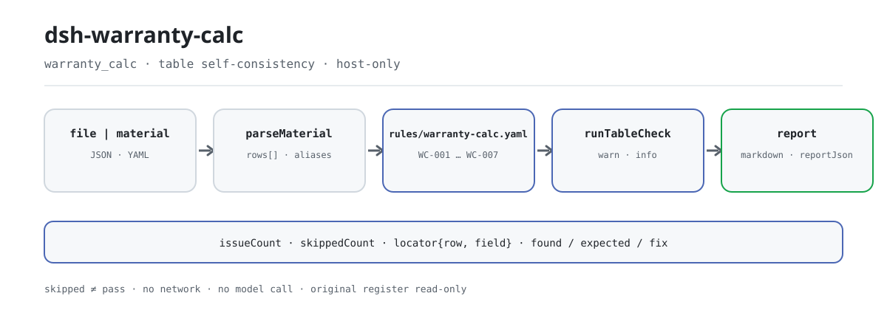

<div align="center">

<picture>
  <source media="(prefers-color-scheme: dark)" srcset="docs/assets/dsh-warranty-calc-flow-dark.svg">
  
</picture>

# dsh-warranty-calc

**Señalar, reclamación por reclamación, cada incoherencia aritmética y de plazo del registro de reclamaciones de garantía: qué fila, qué columna y qué difiere.**

Un verificador local para la gestión de contratos y la liquidación de garantías: no hace falta saber usar la línea de comandos, el original nunca se modifica, no hay red ni llamada al modelo. Excel puede convertirse antes a JSON/YAML (también en el chat, si la plataforma lo permite).

[Instalación](#instalación-en-tres-pasos) · [Configuración](#configuración) · [FAQ](#faq) · [简体中文](README.md) · [English](README.en.md) · [Español](README.es.md) · [Português](README.pt.md) · [हिन्दी](README.hi.md)

[](LICENSE)
[](#compatibilidad)
[](https://www.npmjs.com/package/dsh-warranty-calc)
[](https://github.com/PerryLink/dsh-warranty-calc/actions/workflows/ci.yml)
[](#compatibilidad)

[](https://github.com/PerryLink/dsh-warranty-calc/stargazers)
[](https://www.npmjs.com/package/dsh-warranty-calc)
[](https://dshfind.com/plugins/PerryLink/dsh-warranty-calc?ref=badge)
[](https://securityscorecards.dev/viewer/?uri=github.com/PerryLink/dsh-warranty-calc)
[](https://dsh.market/)
[](https://gitee.com/perrylink/dsh-warranty-calc)

```sh
dsh plugin --profile <name> add dsh-warranty-calc
```

</div>

<sub>Plugin de la comunidad, sin relación con DeepSeek. Repositorio canónico: <https://github.com/PerryLink/dsh-warranty-calc> (Gitee es un espejo).</sub>

## Qué es

`dsh-warranty-calc` lee un registro de reclamaciones de garantía —la cabecera del concesionario más una fila por reclamación— y comprueba la aritmética y la coherencia de plazos de ese mismo registro: que cada reclamación anote su número de reclamación o el nombre de la pieza, que la fecha de la reclamación caiga dentro de la fecha de fin de garantía que el registro declara, que el kilometraje en la reclamación se pueda analizar como número y no supere el límite de kilometraje que el registro declara, que el importe reclamado sea igual a cantidad × precio unitario, que la fecha de venta no sea posterior a la fecha de la reclamación y que no se repitan los números de reclamación.

Solo devuelve las diferencias que puede señalar dentro del material, con su localización (fila, columna), lo esperado y la corrección; no decide si una reclamación debe aceptarse o si una avería está cubierta, no emite juicios de conformidad ni de responsabilidad, ni sustituye al revisor. Es local, sin dependencias, sin red y sin llamada al modelo; el original es de solo lectura.

## Instalación en tres pasos

1. **Instalar** (publicado en npm):

   ```sh
   dsh plugin --profile <name> add dsh-warranty-calc
   ```

2. **Confirmar que se monta**:

   ```sh
   dsh --profile <name> --dump-config | grep 'dsh-warranty-calc'
   ```

3. **Ejecutar una vez**: entregue el registro (JSON/YAML) a la herramienta `warranty_calc` mediante `file` o `material`. Entrada mínima:

   ```json
   {"rows":[{"数量":"2","单价":"180","索赔金额":"400"}]}
   ```

   El primer hallazgo, `WC-005`, indica que la fila 1 declara 400 en `claimAmount` mientras que 2 × 180 = 360.

**Desinstalar**: `dsh plugin --profile <name> remove dsh-warranty-calc` (o elimine la fila del patch del perfil).

El repositorio incluye un quickstart repetible (el script importa `lib/index.mjs`, así que compile primero):

```sh
pnpm run build
node samples/quickstart/run.mjs
```

El ejemplo está en `samples/quickstart/input/`, el resumen esperado en `samples/quickstart/expected/result.json` y una captura de terminal en `docs/assets/quickstart.png`.

También puede omitir la instalación: busque «Tender Compliance Suite» en WorkBuddy / Coze (esta comprobación es una de sus partes; disponibilidad según catálogo).

## Capacidades clave

La herramienta se registra como `warranty_calc`: lee un registro de reclamaciones, aplica un paquete de reglas versionado y devuelve un informe.

- **Siete reglas en una pasada** — `WC-001`–`WC-007` cubren la información mínima de trazabilidad, la ventana de fechas dentro del período de garantía, la analizabilidad del kilometraje, el límite de kilometraje, la aritmética de piezas, el orden venta/reclamación y los números de reclamación duplicados; el paquete de reglas está versionado en `rules/warranty-calc.yaml`.
- **Cada hallazgo cae en una fila y una columna** — el informe lleva `ruleId`, `severity`, `locator.row` / `locator.field`, `found`, `expected` y `fix`; enumera diferencias y no emite un veredicto.
- **El fallo nunca es silencioso** — toda comprobación que no puede ejecutarse entra en `skipped` con su motivo; una regla a la que le falta su columna obligatoria se declara a sí misma en lugar de pasar.
- **Las reglas son datos** — sustituir `rules/*.yaml` cambia el conjunto de reglas sin tocar TypeScript; el cargador valida la cita y el techo de severidad.
- **Local y sin dependencias** — sin red, sin llamada al modelo, sin código nativo; una llamada lee únicamente el material que usted entrega.
- **Seguro en concurrencia** — la herramienta declara `isConcurrencySafe`, así que varios registros pueden verificarse en paralelo sin estado de sesión compartido.

| Regla | Qué comprueba | Severidad | Tipo de base |
|---|---|---|---|
| `WC-001` | la reclamación anota su número o el nombre de la pieza | warn | direct |
| `WC-002` | la fecha de la reclamación cae dentro del fin de garantía declarado | info | local |
| `WC-003` | el kilometraje en la reclamación se analiza como número | warn | principle |
| `WC-004` | el kilometraje no supera el límite declarado | info | local |
| `WC-005` | el importe reclamado es igual a cantidad × precio unitario | warn | direct |
| `WC-006` | la fecha de venta no es posterior a la de la reclamación | warn | principle |
| `WC-007` | los números de reclamación no se repiten | warn | principle |

Tipos de base: `direct` = la cláusula establece el requisito directamente; `principle` = inferido de una cláusula de principio (`derived-from-principle`, severidad máxima `warn`); `local` = configuración institucional (`institutional-configuration`, máximo `info`).

### Ejemplos

La salida detallada siguiente es la salida real del plugin sobre el fixture `WC-005`, no un montaje.

**Herramienta** `warranty_calc`

**Entrada**

```json
{"rows":[{"数量":"2","单价":"180","索赔金额":"400"}]}
```

**Salida**

```json
{
  "id": "dsh-warranty-calc.WC-005.41a857ae",
  "ruleId": "WC-005",
  "severity": "warn",
  "locator": {
    "column": "claimAmount",
    "row": 1
  },
  "found": "第 1 行「claimAmount」填报 400，而 2 × 180 = 360",
  "expected": "「claimAmount」应等于 quantity × unitPrice",
  "fix": "核对是否抄错或漏改；本条只做算术核对，不判断各因子是否正确",
  "basis": "《家用汽车产品修理更换退货责任规定》（市场监管总局令第43号（2021 年 7 月 22 日公布，自 2022 年 1 月 1 日起施行）） 第十九条（免费修理，包括免除工时费和材料费）：「家用汽车产品在包修期内出现质量问题或者易损耗零部件在其质量保证期内出现质量问题的，消费者可以凭三包凭证选择修理者免费修理（包括免除工时费和材料费）。」"
}
```

*Observado en `dsh-warranty-calc/tests/fixtures/WC-005/WC-005-unsafe.json`*

Otra muestra real viene del quickstart:

```text
$ node samples/quickstart/run.mjs
warranty_calc: 1 issue(s) — error 0, warn 1, info 0
skipped: 1
```

*Observado en `samples/quickstart/expected/result.json`*

## Normas que sigue

| Documento | Número | Reglas que lo citan |
|---|---|---|
| Provisions on the Liability for Repair, Replacement and Return of Household Automobile Products | Orden SAMR n.º 43 (publicada el 22 de julio de 2021, en vigor desde el 1 de enero de 2022) | WC-001, WC-003, WC-005, WC-006, WC-007 |
| Políticas de garantía de fabricantes y normas de las tres garantías (configuración institucional) | Sin norma unificada (esta regla se basa en el período de garantía registrado en el libro) | WC-002 |
| Políticas de garantía de fabricantes (configuración institucional) | Sin norma unificada (esta regla se basa en el límite de kilometraje registrado en el libro) | WC-004 |

**Límite:** este plugin comprueba la aritmética y la coherencia de plazos de un **registro de reclamaciones de garantía** — que cada reclamación anote su número o el nombre de la pieza, que la fecha de la reclamación caiga dentro de la fecha de fin de garantía declarada, que el kilometraje se analice y no supere el límite declarado, que el importe sea cantidad × precio unitario, que la fecha de venta no sea posterior a la de la reclamación y que los números no se repitan. **No** decide si una reclamación debe aceptarse, si una avería está cubierta ni si la causó un uso indebido o el desgaste normal.

> ### ⚠️ La política de garantía es del fabricante y este paquete no finge citar una
>
> La duración del período, el límite de kilometraje, las tarifas de mano de obra y las franquicias los fija **la política de garantía de cada fabricante** y las normas de las tres garantías del producto correspondiente. **No existe una norma unificada**, así que el `basis` de cada regla lo dice y se queda en `warn` o `info`.
>
> Hay tres consecuencias que conviene conocer antes de fiarse de un hallazgo:
>
> - **El plugin nunca calcula la fecha de fin de garantía.** No calcula «fecha de venta + 36 meses», porque los meses tienen distinta duración y el período puede empezar en la entrega o en la matriculación y no en la venta: una fecha calculada parecería precisa y podría ser falsa. **Usted calcula la fecha según la política aplicable y la escribe en la columna de fin de garantía (`warrantyEndAt`)**; `WC-002` compara con ella.
> - **El límite de kilometraje de `WC-004` también sale del libro.** No hay ninguna cifra incorporada; un hallazgo significa «por encima del límite que usted registró», nunca «fuera de garantía»: el tiempo y el kilometraje son **límites independientes, el que se cumpla primero**, y las políticas difieren en qué ocurre tras superar cualquiera de ellos.
> - **`WC-005` cubre solo las piezas.** Los importes reales suelen sumar mano de obra y materiales y restar una franquicia, y este libro tiene columnas separadas para ello. Un libro que liquide como «piezas + mano de obra − franquicia» reportará una diferencia; apunte `resultField` a una columna de importe de piezas o desactive la regla.
>
> **El `excerpt` del paquete de reglas solo contiene una de dos cosas: una cita literal obtenida, o la declaración explícita de que la regla se basa en una configuración institucional y no existe texto de cláusula citable; el paquete nunca inventa una cita.** Los `excerpt` de `WC-001`, `WC-003`, `WC-005`, `WC-006` y `WC-007` se sustituyeron por citas literales el 2026-10-07 (registro de verificación en `rules/evidence/`); `WC-002` y `WC-004` son configuraciones institucionales con `kind: institutional-configuration` y techo de severidad `info`.

## Configuración

Todos los parámetros ajustables son campos Schemastery de `src/config.ts`, por lo que se cambian desde `cordis.yml` sin tocar el código; los umbrales por regla están en el paquete de reglas bajo `rules/`.

| Clave | Tipo | Predeterminado | Descripción |
|---|---|---|---|
| `rulesFile` | string | `rules/warranty-calc.yaml` | Ruta del paquete de reglas, relativa a la raíz del paquete |
| `disabledRules` | string[] | `[]` | Ids de reglas que se dejan de ejecutar; cada una aparece en `skipped` |
| `onlyRules` | string[] | `[]` | Ejecutar solo estas reglas; vacío ejecuta todas |
| `skipNotes` | string | `""` | Nota añadida a cada motivo de `skipped` |
| `timeoutMs` | number | `120000` | Presupuesto de tiempo de espera cooperativo de la herramienta |

Parámetros por regla que conviene conocer:

- `WC-002` necesita la columna de fin de garantía (`warrantyEndAt`) del libro; sin ella la regla se declara en `skipped`. El plugin nunca calcula esa fecha a partir de un número de meses.
- `WC-004` necesita `warrantyMiles` del libro. No hay ninguna cifra de kilometraje incorporada.
- `WC-005` `resultField` / `factorFields` / `tolerance`: la aritmética de piezas; reoriente `resultField` si su liquidación incluye mano de obra y franquicia.

Ejemplo de sobrescritura en el patch del perfil:

```yaml
- insert:
    - id: dsh-warranty-calc
      name: dsh-warranty-calc
      config:
        disabledRules: [WC-005]
        skipNotes: Política de garantía institucional 2026
```

## Formato del material

La herramienta acepta JSON o YAML:

```yaml
dealer: 某某服务站
manufacturer: 某某厂商
policyVersion: 2026 版质保政策
rows:
  - { 索赔单号: SP-2026-0018, 配件名称: 前制动片, 销售日期: 2024-03-10,
      索赔时里程: '48600', 质保期月数: '36', 质保里程: '100000',
      质保期截止日: 2027-03-09, 索赔日期: 2026-03-05,
      数量: '2', 单价: '180', 索赔金额: '360', 处理结论: 同意索赔 }
```

Los nombres de columna se comparan sin distinguir mayúsculas y minúsculas, ignorando espacios, guiones bajos y guiones; se conservan los nombres propios del libro, de modo que el hallazgo nombra la columna que leyó. Los campos son opcionales en la capa de lectura y los valida el motor, así que una exportación parcial produce hallazgos de «falta» en lugar de un fallo.

## Fuentes de las reglas

Los datos de las reglas están separados del código y viven en `rules/warranty-calc.yaml`. Como la política de garantía es un instrumento del fabricante y no una norma, el `basis` del paquete lo dice expresamente en lugar de citar una. El cargador sigue exigiendo documento, número, cláusula, extracto, tipo y fuente por regla, y sigue exigiendo que `excerpt` sea una cita literal de al menos ocho caracteres. Una regla basada solo en un principio general (`kind: derived-from-principle`, techo `warn`) o en una configuración institucional (`kind: institutional-configuration`, techo `info`) no puede declararse `error`. Un paquete que exagera su base falla al cargar en lugar de producir un informe falsamente seguro.

Los límites verificados y las conclusiones deliberadamente **no** afirmadas están en `rules/evidence/`.

## FAQ

<details>
<summary>El registro no tiene fecha de fin de garantía. ¿La comprobación de la fecha de la reclamación pasa sin más?</summary>

No. `WC-002` aparece en `skipped` cuando la columna del fin de garantía está vacía: no supone ningún plazo ni lo calcula a partir de la fecha de venta. Con la columna rellena solo comprueba que la fecha de la reclamación quede entre la fecha de venta y la fecha de fin que usted escribió, y una diferencia significa que no concuerda con el plazo de su propio registro, no que la reclamación esté fuera de garantía.

</details>

<details>
<summary>El importe reclamado no es igual a cantidad × precio unitario, ¿se detecta?</summary>

Sí. `WC-005` señala la fila cuando `claimAmount` se aparta de `quantity` × `unitPrice` más de la tolerancia de 0.01. Cubre solo el importe de las piezas: si su registro liquida como piezas + mano de obra − franquicia (`laborHours`, `laborRate` y `deductible` son columnas aparte), la regla informará de una diferencia; apunte `resultField` a una columna de importe de piezas o desactive la regla. No juzga si el precio unitario es razonable ni si la pieza debía sustituirse.

</details>

<details>
<summary>El kilometraje figura como `48,600 公里`, ¿se lee igual? ¿Y si supera el límite?</summary>

Sí. `WC-003` toma la parte numérica, así que `48600` y `48,600 公里` se analizan; solo informa del kilometraje que no puede analizar y no juzga si supera el límite. De esa comparación se ocupa `WC-004`, que solo contrasta con el límite `warrantyMiles` que declara el registro —ninguna cifra está incorporada— y cuyo hallazgo significa «por encima del límite que usted registró», nunca «fuera de garantía»: tiempo y kilometraje son límites independientes, el que se cumpla primero.

</details>

<details>
<summary>El mismo número de reclamación aparece en dos filas.</summary>

`WC-007` informa de un `claimNo` repetido, ignorando los espacios, porque la repetición duplica el total reclamado e impide que el fabricante case la línea. Registrar una misma reclamación en varias filas por piezas distintas es normal: distíngalas en la columna del nombre de la pieza.

</details>

<details>
<summary>Una fila no tiene número de reclamación ni nombre de pieza.</summary>

`WC-001` señala la fila solo cuando no está relleno ni `claimNo` ni `partName`: basta con uno de los dos. Comprueba que esté la información mínima de trazabilidad, no si la reclamación está dentro de garantía o debe aceptarse.

</details>

<details>
<summary>La fecha de venta es posterior a la fecha de la reclamación.</summary>

`WC-006` compara las dos fechas del registro y señala la fila cuando `saleDate` es posterior a `claimDate`. La fecha de inicio se toma de su columna de fecha de venta: la cláusula que cita la regla nombra la fecha de factura y la fecha de entrega como puntos de inicio, la regla no elige por usted y el inicio real sigue el compromiso del fabricante. Una fecha que no puede analizar se informa aparte, no se omite en silencio.

</details>

## Límites de seguridad

- **El original es de solo lectura.** La herramienta lee solo el archivo indicado en `file` o el texto en línea de `material`; la declaración demo de `package.json` establece `writes: []`, `network: false` y `external: []`, y registra que la herramienta lee el archivo de material que usted indica. No modifica el registro ni guarda un informe por su cuenta.
- **Sin red y sin llamada al modelo.** ESM puro, sin dependencias, sin código nativo; el informe se calcula por completo con reglas locales y la entrada.
- **Sin veredicto.** El informe enumera diferencias y siempre lleva una advertencia fija; las pruebas afirman que la salida no contiene lenguaje calificador («conforme», «infracción», «aprobado») ni conclusiones sobre responsabilidad o cobertura.
- **La disciplina de citas se aplica al cargar.** Cada regla debe llevar documento, número, cláusula, extracto, tipo y fuente; `excerpt` debe ser una cita literal de al menos ocho caracteres; una configuración institucional no puede declararse `error`. Un paquete que no cumple no carga.
- **Fallo cerrado.** Si no se puede resolver la ruta del paquete de reglas, el plugin lanza un error y enumera todas las ubicaciones probadas; nunca cambia en silencio a otro paquete. Si falla la validación del paquete, falla toda la llamada.
- **El registro es un efecto.** El registro de la herramienta devuelve un disposer; descargar o recargar en caliente lo elimina.

## Limitaciones conocidas

- **La política de garantía es del fabricante y no hay norma unificada.** La duración, el límite de kilometraje, las tarifas de mano de obra y las franquicias varían por fabricante y categoría; el `basis` de cada regla lo dice y la severidad se queda en `warn` / `info`.
- **Nunca se calcula la fecha de fin de garantía.** No se calcula «fecha de venta + N meses»: los meses tienen distinta duración, el inicio puede ser la fecha de factura o la de entrega, y el período de las tres garantías y el de reparación son dos plazos distintos. Estas razones se verificaron literalmente contra el artículo 18 de las Provisions on the Liability for Repair, Replacement and Return of Household Automobile Products y se registran en `rules/evidence/`. El usuario calcula la fecha según la política aplicable y la escribe en el registro.
- **El límite de `WC-004` sale del registro.** No hay ninguna cifra de kilometraje incorporada; un hallazgo significa «por encima del límite que usted registró», nunca «fuera de garantía»: tiempo y kilometraje son límites independientes, el que se cumpla primero.
- **`WC-005` cubre solo el importe de piezas.** Un registro que liquide como piezas + mano de obra − franquicia reportará una diferencia; reoriente `resultField` o desactive la regla.
- **El análisis de fechas es limitado.** Se aceptan `2026-03-05` o `2026-03-05 09:30`; `2026年3月5日` se informa como no analizable a propósito, nunca se convierte en silencio.
- **No se juzga la aceptación, la responsabilidad ni la cobertura.** Eso requiere un técnico y la política del fabricante; es decisión del revisor de la reclamación.
- **Este paquete de reglas llega como máximo a `warn`.** Ninguna de las siete reglas produce un hallazgo `error`; una configuración institucional se limita a `info` y una inferencia de principio a `warn`.
- **El tiempo es aritmética de reloj de pared sobre las cadenas de entrada**, sin conversión de zona horaria.

## Solución de problemas

- **El plugin se instala pero la herramienta no aparece.** Compruebe que `main` resuelve a `lib/index.mjs` y que `pnpm run build` lo generó; un `main` incorrecto hace que el cargador omita la entrada en silencio.
- **`dsh plugin add` rechaza el paquete como incompatible.** La franja de peers cubre `0.1.x` y `0.2.x`; si su entorno queda fuera, conceda una exención explícita: `dsh plugin --profile <name> allow-version <pkg@version> --dsh-version <runtime> --accept-risk`
- **Una regla no se ejecutó.** Lea el arreglo `skipped`; indica el id de la regla y el motivo.
- **`WC-002` se declara en skipped.** El registro no tiene fecha de fin de garantía; el plugin no la calcula por usted.
- **`WC-002` se activa aunque creo que la reclamación está cubierta.** La fecha de fin registrada no concuerda con la fecha de la reclamación. Revise cómo se calculó la fecha según la política aplicable.
- **`WC-004` se activa en una reclamación que considero cubierta.** El kilometraje supera el límite que usted registró, pero tiempo y kilometraje son límites independientes; este hallazgo por sí solo no significa que la reclamación esté fuera de garantía.
- **`WC-005` se activa en una liquidación correcta.** El importe probablemente incluye mano de obra y una franquicia. Apunte `resultField` a una columna de piezas o desactive la regla.
- **`check` informa `manifest-peers` como fallo.** El verificador estático compara con una franja de peers codificada que es anterior a la línea 0.2; el runtime aplica la compatibilidad al instalar. Es un problema conocido de `dsh-plugin-dev`.
- **Los horarios parecen desplazados.** Toda la aritmética es de hora local sobre las cadenas de entrada; no se convierte la zona horaria.

## Interoperabilidad con otros plugins DSH

Este plugin registra exactamente una herramienta, `warranty_calc`; no registra escuchadores de eventos, claves de servicio, slots de cliente ni rutas `webServer`, así que no compite por esas superficies:

- **Superficie de herramientas**: el único registro es `warranty_calc`, hecho con `ctx.tools.register`, que devuelve el disposer que lo elimina al descargar o recargar en caliente.
- **Sin claves de servicio ni slots**: no ofrece ningún servicio ni registra una clave de slot de cliente, así que no compite por un asiento de `shadows-shipped-ui`.
- **Sin rutas HTTP**: no registra ningún prefijo `webServer`.
- **Sin colisión de capa de patch**: el `cordis.patch.yml` del paquete solo `insert`a su propia fila; nunca sobrescribe el `config` de una fila integrada.
- **Sin mutación global**: no parchea prototipos, no reescribe `process.env` ni sustituye el despachador fetch global.
- **Seguro en concurrencia**: declara `isConcurrencySafe`, así que varios registros pueden verificarse en paralelo sin estado de sesión mutable compartido.

## Compatibilidad

| Superficie | Estado |
|---|---|
| Harness | Rango de peers `>=0.1.2-rc.1 <0.2.0 \|\| >=0.2.0-0 <0.3.0` — verificado para aceptar tanto `0.2.0-rc.2` como `0.2.1-rc.2`. `engines.dsh` se declara como `>=0.2.1-0 <0.3.0` y el host lo aplica desde 0.2.1 |
| Node | `^22.19.0 \|\| >=24.0.0` |
| Plataformas | Todas (ESM puro; sin código nativo, sin red, sin llamada al modelo) |
| Modo de herramienta | Funciona en `native` y `ptc`; para un lote de reclamaciones use `ptc` y pague el coste del esquema una sola vez |

## Ecosistema y calidad

- [Espejo en Gitee](https://gitee.com/perrylink/dsh-warranty-calc) (espejo sincronizado; GitHub es la referencia)
- [Página de dshfind](https://dshfind.com/plugins/PerryLink/dsh-warranty-calc) (instalaciones y ranking)
- [Informe OpenSSF Scorecard](https://securityscorecards.dev/viewer/?uri=github.com/PerryLink/dsh-warranty-calc) (impulsado por [.github/workflows/scorecard.yml](.github/workflows/scorecard.yml))
- [DSH Market](https://dsh.market/) (en catálogo)
- [Página del paquete npm](https://www.npmjs.com/package/dsh-warranty-calc) (versión y descargas)
- [Elegir un verificador por material](https://perrylink.github.io/zh/checkers/choose/) (índice de selección de la familia)

## Desarrollo

```sh
pnpm install
pnpm run typecheck   # tsc --noEmit
pnpm test            # vitest, suite compartida de plugins de tabla + fixtures emparejados
pnpm run build       # tsdown -> lib/index.mjs + lib/index.d.mts
pnpm run verify:self-contained
pnpm run check:lockfile
pnpm run check:readmes
pnpm pack
node ../scripts/sync-shared.mjs dsh-warranty-calc
```

El plugin es **data-only**: `src/model.ts` declara la forma de la tabla y los alias de campo, el kit compartido aporta el lector y el motor de comprobación, y el paquete de reglas declara cada comprobación. El último comando copia el kit compartido de `../_shared` a `src/shared/`; vuelva a ejecutarlo tras cada cambio compartido. El quickstart está en `samples/quickstart/`.

Las imágenes del README se generan con [`scripts/gen-readme-assets.py`](scripts/gen-readme-assets.py) (Python + Pillow) y se pueden volver a ejecutar:

```sh
python scripts/gen-readme-assets.py
```

Topics: `dsh`, `dsh-plugin`, `deepseek-harness`, `deepseek`, `cordis`, `warranty`, `calc`

## Familia y agradecimientos

Este proyecto forma parte de la familia de plugins de DeepSeek Harness de [PerryLink](https://github.com/PerryLink) (todos Apache-2.0). Si le resulta útil, **una estrella ayuda a que la siguiente persona lo encuentre**; no desbloquea nada.

- [@PerryLink](https://github.com/PerryLink) — creador y mantenedor: el paquete de reglas de reclamaciones de garantía, el motor de comprobación de tablas, la herramienta `warranty_calc`, los fixtures emparejados y la documentación en cinco idiomas.

<details>
<summary>Ver todos los plugins</summary>

| Plugin | Estado |
|---|---|
| **[dsh-aqua-input-check](https://github.com/PerryLink/dsh-aqua-input-check)** |  |
| **[dsh-archive-check](https://github.com/PerryLink/dsh-archive-check)** |  |
| **[dsh-auto-review](https://github.com/PerryLink/dsh-auto-review)** |  |
| **[dsh-autotier](https://github.com/PerryLink/dsh-autotier)** | 🧊 CONGELADO — ver el README del repo |
| **[dsh-bid-ca-precheck](https://github.com/PerryLink/dsh-bid-ca-precheck)** |  |
| **[dsh-bid-qual-check](https://github.com/PerryLink/dsh-bid-qual-check)** |  |
| **[dsh-cert-mcp](https://github.com/PerryLink/dsh-cert-mcp)** | 🧊 CONGELADO — ver el README del repo |
| **[dsh-checkpoint-rewind](https://github.com/PerryLink/dsh-checkpoint-rewind)** |  |
| **[dsh-click](https://github.com/PerryLink/dsh-click)** |  |
| **[dsh-composer-history](https://github.com/PerryLink/dsh-composer-history)** |  |
| **[dsh-contract-stance](https://github.com/PerryLink/dsh-contract-stance)** |  |
| **[dsh-customs-doc-check](https://github.com/PerryLink/dsh-customs-doc-check)** |  |
| **[dsh-data-quality](https://github.com/PerryLink/dsh-data-quality)** | 🧊 CONGELADO — ver el README del repo |
| **[dsh-demurrage-ledger](https://github.com/PerryLink/dsh-demurrage-ledger)** |  |
| **[dsh-doublecheck](https://github.com/PerryLink/dsh-doublecheck)** |  |
| **[dsh-drill-script-check](https://github.com/PerryLink/dsh-drill-script-check)** |  |
| **[dsh-eia-guide-check](https://github.com/PerryLink/dsh-eia-guide-check)** |  |
| **[dsh-emergency-plan](https://github.com/PerryLink/dsh-emergency-plan)** |  |
| **[dsh-essay-rubric-check](https://github.com/PerryLink/dsh-essay-rubric-check)** |  |
| **[dsh-evidence-check](https://github.com/PerryLink/dsh-evidence-check)** |  |
| **[dsh-export-ctl-check](https://github.com/PerryLink/dsh-export-ctl-check)** |  |
| **[dsh-fast](https://github.com/PerryLink/dsh-fast)** |  |
| **[dsh-fmea-table-check](https://github.com/PerryLink/dsh-fmea-table-check)** |  |
| **[dsh-forecast-penalty](https://github.com/PerryLink/dsh-forecast-penalty)** |  |
| **[dsh-fund-research](https://github.com/PerryLink/dsh-fund-research)** |  |
| **[dsh-github](https://github.com/PerryLink/dsh-github)** |  |
| **[dsh-gongwen-flow-check](https://github.com/PerryLink/dsh-gongwen-flow-check)** |  |
| **[dsh-gongwen-word-check](https://github.com/PerryLink/dsh-gongwen-word-check)** |  |
| **[dsh-guard-plan-qc](https://github.com/PerryLink/dsh-guard-plan-qc)** |  |
| **[dsh-hazchem-check](https://github.com/PerryLink/dsh-hazchem-check)** |  |
| **[dsh-hazplan-check](https://github.com/PerryLink/dsh-hazplan-check)** |  |
| **[dsh-hidden-risk-map](https://github.com/PerryLink/dsh-hidden-risk-map)** |  |
| **[dsh-hs-classify](https://github.com/PerryLink/dsh-hs-classify)** |  |
| **[dsh-icd-rule-check](https://github.com/PerryLink/dsh-icd-rule-check)** |  |
| **[dsh-industry-research](https://github.com/PerryLink/dsh-industry-research)** |  |
| **[dsh-lawcite-adapter](https://github.com/PerryLink/dsh-lawcite-adapter)** |  |
| **[dsh-laya](https://github.com/PerryLink/dsh-laya)** |  |
| **[dsh-lc-doc-check](https://github.com/PerryLink/dsh-lc-doc-check)** |  |
| **[dsh-learning-gap-check](https://github.com/PerryLink/dsh-learning-gap-check)** |  |
| **[dsh-library](https://github.com/PerryLink/dsh-library)** |  |
| **[dsh-local-ai](https://github.com/PerryLink/dsh-local-ai)** |  |
| **[dsh-lsp-actions](https://github.com/PerryLink/dsh-lsp-actions)** |  |
| **[dsh-mask](https://github.com/PerryLink/dsh-mask)** |  |
| **[dsh-mcp-panel](https://github.com/PerryLink/dsh-mcp-panel)** |  |
| **[dsh-medrec-qc](https://github.com/PerryLink/dsh-medrec-qc)** |  |
| **[dsh-memento](https://github.com/PerryLink/dsh-memento)** | 🧊 CONGELADO — ver el README del repo |
| **[dsh-nsfc-form-check](https://github.com/PerryLink/dsh-nsfc-form-check)** |  |
| **[dsh-nurse-record-check](https://github.com/PerryLink/dsh-nurse-record-check)** |  |
| **[dsh-observe](https://github.com/PerryLink/dsh-observe)** |  |
| **[dsh-origin-rvc-check](https://github.com/PerryLink/dsh-origin-rvc-check)** |  |
| **[dsh-ota-review-check](https://github.com/PerryLink/dsh-ota-review-check)** |  |
| **[dsh-output-styles](https://github.com/PerryLink/dsh-output-styles)** |  |
| **[dsh-paper-doc-adapter](https://github.com/PerryLink/dsh-paper-doc-adapter)** |  |
| **[dsh-permission-rules](https://github.com/PerryLink/dsh-permission-rules)** |  |
| **[dsh-permit-report-check](https://github.com/PerryLink/dsh-permit-report-check)** |  |
| **[dsh-pipeline-check](https://github.com/PerryLink/dsh-pipeline-check)** |  |
| **[dsh-pleading-draft](https://github.com/PerryLink/dsh-pleading-draft)** |  |
| **[dsh-plugin-doctor](https://github.com/PerryLink/dsh-plugin-doctor)** | 🚫 RETIRADO (repo archivado) |
| **[dsh-plugin-guide](https://github.com/PerryLink/dsh-plugin-guide)** |  |
| **[dsh-plugin-kit](https://github.com/PerryLink/dsh-plugin-kit)** | 🚫 RETIRADO (repo archivado) |
| **[dsh-plugin-upgrade](https://github.com/PerryLink/dsh-plugin-upgrade)** | 🚫 RETIRADO (repo archivado) |
| **[dsh-policy-brief-draft](https://github.com/PerryLink/dsh-policy-brief-draft)** |  |
| **[dsh-power-loss-split](https://github.com/PerryLink/dsh-power-loss-split)** |  |
| **[dsh-power-ticket-check](https://github.com/PerryLink/dsh-power-ticket-check)** |  |
| **[dsh-ppap-check](https://github.com/PerryLink/dsh-ppap-check)** |  |
| **[dsh-protest-deadline](https://github.com/PerryLink/dsh-protest-deadline)** |  |
| **[dsh-railway-window](https://github.com/PerryLink/dsh-railway-window)** |  |
| **[dsh-repair-order-qc](https://github.com/PerryLink/dsh-repair-order-qc)** |  |
| **[dsh-research-report](https://github.com/PerryLink/dsh-research-report)** |  |
| **[dsh-review-reply-check](https://github.com/PerryLink/dsh-review-reply-check)** |  |
| **[dsh-rulefile-check](https://github.com/PerryLink/dsh-rulefile-check)** |  |
| **[dsh-safety-brief-check](https://github.com/PerryLink/dsh-safety-brief-check)** |  |
| **[dsh-score](https://github.com/PerryLink/dsh-score)** | 🧊 CONGELADO — ver el README del repo |
| **[dsh-session-sync](https://github.com/PerryLink/dsh-session-sync)** |  |
| **[dsh-site-log-check](https://github.com/PerryLink/dsh-site-log-check)** |  |
| **[dsh-skill-pack-security](https://github.com/PerryLink/dsh-skill-pack-security)** |  |
| **[dsh-soe-decision-check](https://github.com/PerryLink/dsh-soe-decision-check)** |  |
| **[dsh-soilwater-check](https://github.com/PerryLink/dsh-soilwater-check)** |  |
| **[dsh-sop-sync-check](https://github.com/PerryLink/dsh-sop-sync-check)** |  |
| **[dsh-spc-gbt-adapter](https://github.com/PerryLink/dsh-spc-gbt-adapter)** |  |
| **[dsh-talk](https://github.com/PerryLink/dsh-talk)** |  |
| **[dsh-tender-extract](https://github.com/PerryLink/dsh-tender-extract)** |  |
| **[dsh-tender-matrix](https://github.com/PerryLink/dsh-tender-matrix)** |  |
| **[dsh-test-drive](https://github.com/PerryLink/dsh-test-drive)** |  |
| **[dsh-ticktick](https://github.com/PerryLink/dsh-ticktick)** | 🚫 RETIRADO (repo archivado) |
| **[dsh-translate](https://github.com/PerryLink/dsh-translate)** |  |
| **[dsh-warranty-calc](https://github.com/PerryLink/dsh-warranty-calc)** |  |
| **[dsh-budget](https://github.com/PerryLink/dsh-budget)** | 🧊 CONGELADO — ver el README del repo |
| **[dsh-claude-move](https://github.com/PerryLink/dsh-claude-move)** | 🧊 CONGELADO — ver el README del repo |
| **[dsh-defend](https://github.com/PerryLink/dsh-defend)** | 🧊 CONGELADO — ver el README del repo |
| **[dsh-draw](https://github.com/PerryLink/dsh-draw)** | 🧊 CONGELADO — ver el README del repo |
| **[dsh-reach](https://github.com/PerryLink/dsh-reach)** | 🧊 CONGELADO — ver el README del repo |
| **[dsh-background-agents](https://github.com/PerryLink/dsh-background-agents)** | 🚫 RETIRADO (repo archivado) |
| **[dsh-session-pin](https://github.com/PerryLink/dsh-session-pin)** | 🚫 RETIRADO (repo archivado) |
| **[dsh-team-rooms](https://github.com/PerryLink/dsh-team-rooms)** | 🚫 RETIRADO (repo archivado) |

</details>

## Licencia

[LICENSE](LICENSE) (Apache License 2.0) © 2026 dsh-warranty-calc contributors

<p align="center"><sub>Apache-2.0 · Plugin de la comunidad, sin relación con DeepSeek.</sub></p>
