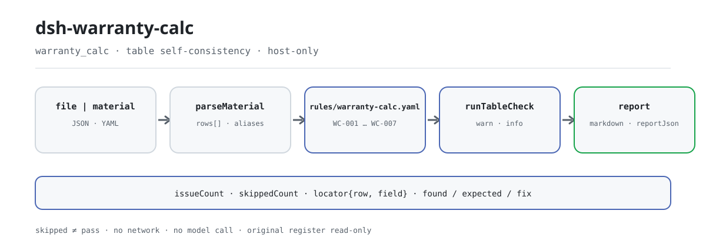

<div align="center">

<picture>
  <source media="(prefers-color-scheme: dark)" srcset="docs/assets/dsh-warranty-calc-flow-dark.svg">
  
</picture>

# dsh-warranty-calc

**वारंटी दावा रजिस्टर की हर अंकगणितीय और अवधि-संबंधी असंगति को दावे-दर-दावे इंगित करें — कौन-सी पंक्ति, कौन-सा कॉलम, क्या अंतर है।**

अनुबंध प्रबंधन और वारंटी निपटान के लिए शुद्ध होस्ट-साइड जाँच प्लगइन: कमांड लाइन जानने की ज़रूरत नहीं, मूल दस्तावेज़ कभी नहीं बदलता, कोई नेटवर्क नहीं, कोई मॉडल कॉल नहीं; Excel को पहले JSON/YAML में बदला जा सकता है (चैट में भी, यदि प्लेटफ़ॉर्म अनुमति दे)।

[इंस्टॉल](#तीन-चरणों-में-शुरुआत) · [कॉन्फ़िगरेशन](#कॉन्फ़िगरेशन) · [FAQ](#faq) · [简体中文](README.md) · [English](README.en.md) · [Español](README.es.md) · [Português](README.pt.md) · [हिन्दी](README.hi.md)

[](LICENSE)
[](#संगतता)
[](https://www.npmjs.com/package/dsh-warranty-calc)
[](https://github.com/PerryLink/dsh-warranty-calc/actions/workflows/ci.yml)
[](#संगतता)

[](https://github.com/PerryLink/dsh-warranty-calc/stargazers)
[](https://www.npmjs.com/package/dsh-warranty-calc)
[](https://dshfind.com/plugins/PerryLink/dsh-warranty-calc?ref=badge)
[](https://securityscorecards.dev/viewer/?uri=github.com/PerryLink/dsh-warranty-calc)
[](https://dsh.market/)
[](https://gitee.com/perrylink/dsh-warranty-calc)

```sh
dsh plugin --profile <name> add dsh-warranty-calc
```

</div>

<sub>समुदाय प्लगइन, DeepSeek से संबद्ध नहीं। एकमात्र रेपो: <https://github.com/PerryLink/dsh-warranty-calc> (Gitee प्रतिबिंब है)।</sub>

## यह क्या है

`dsh-warranty-calc` वारंटी दावों का एक रजिस्टर पढ़ता है — डीलर हेडर और प्रत्येक दावे की एक पंक्ति — और उसी रजिस्टर के अंकगणित तथा अवधि की आंतरिक संगति की जाँच करता है: क्या प्रत्येक दावे में दावा क्रमांक या पुर्ज़े का नाम दर्ज है, क्या दावे की तारीख रजिस्टर में लिखी वारंटी समाप्ति तिथि के भीतर पड़ती है, क्या दावे के समय की माइलेज संख्या के रूप में पढ़ी जा सकती है और रजिस्टर में लिखी माइलेज सीमा से अधिक नहीं है, क्या दावा राशि मात्रा × इकाई मूल्य के बराबर है, क्या बिक्री तिथि दावे की तारीख के बाद नहीं है, और क्या दावा क्रमांक दोहराए नहीं गए हैं।

यह केवल वे अंतर लौटाता है जिन्हें सामग्री के भीतर इंगित किया जा सकता है, स्थान (पंक्ति, कॉलम), अपेक्षा और सुधार के साथ; यह निर्णय नहीं करता कि दावा स्वीकार होना चाहिए या खराबी वारंटी के दायरे में है, अनुपालन या दायित्व पर कोई निर्णय नहीं देता, और समीक्षक का विकल्प नहीं है। शुद्ध होस्ट-साइड, शून्य निर्भरता, कोई नेटवर्क नहीं, कोई मॉडल कॉल नहीं; मूल दस्तावेज़ केवल पढ़ा जाता है।

## तीन चरणों में शुरुआत

1. **इंस्टॉल करें** (npm पर प्रकाशित):

   ```sh
   dsh plugin --profile <name> add dsh-warranty-calc
   ```

2. **माउंट होने की पुष्टि करें**:

   ```sh
   dsh --profile <name> --dump-config | grep 'dsh-warranty-calc'
   ```

3. **एक बार चलाएँ**: रजिस्टर (JSON/YAML) को `file` या `material` के माध्यम से `warranty_calc` उपकरण को दें। न्यूनतम इनपुट:

   ```json
   {"rows":[{"数量":"2","单价":"180","索赔金额":"400"}]}
   ```

   पहला निष्कर्ष `WC-005` बताएगा कि पंक्ति 1 में `claimAmount` के लिए 400 दर्ज है जबकि 2 × 180 = 360।

**अनइंस्टॉल**: `dsh plugin --profile <name> remove dsh-warranty-calc` (या प्रोफ़ाइल पैच से पंक्ति हटाएँ)।

रेपो में दोबारा चलाया जा सकने वाला quickstart है (स्क्रिप्ट `lib/index.mjs` आयात करती है, इसलिए पहले बिल्ड करें):

```sh
pnpm run build
node samples/quickstart/run.mjs
```

नमूना `samples/quickstart/input/` में, अपेक्षित सारांश `samples/quickstart/expected/result.json` में, और टर्मिनल स्क्रीनशॉट `docs/assets/quickstart.png` में है।

प्लगइन इंस्टॉल किए बिना भी: WorkBuddy / Coze में "Tender Compliance Suite" खोजें (यह जाँच उसका एक हिस्सा है; उपलब्धता कैटलॉग के अनुसार)।

## मुख्य क्षमताएँ

उपकरण `warranty_calc` के रूप में पंजीकृत है: यह एक दावा रजिस्टर पढ़ता है, संस्करणबद्ध नियम-पैक लागू करता है और रिपोर्ट लौटाता है।

- **एक बार में सात नियम** — `WC-001`–`WC-007` न्यूनतम पता-लगाने योग्य सूचना, वारंटी अवधि के भीतर तारीख-खिड़की, माइलेज की पठनीयता, माइलेज सीमा, पुर्ज़ों का अंकगणित, बिक्री/दावा तारीख का क्रम और दोहरे दावा क्रमांक को कवर करते हैं; नियम-पैक `rules/warranty-calc.yaml` में संस्करणबद्ध है।
- **हर निष्कर्ष पंक्ति और कॉलम तक पहुँचता है** — रिपोर्ट में `ruleId`, `severity`, `locator.row` / `locator.field`, `found`, `expected` और `fix` होते हैं; यह अंतर सूचीबद्ध करती है, कोई निर्णय नहीं देती।
- **विफलता कभी मौन नहीं** — जो जाँच नहीं चल सकती वह कारण के साथ `skipped` में जाती है; जिस नियम का अनिवार्य कॉलम अनुपस्थित है वह स्वयं को `skipped` बताता है, चुपचाप पास नहीं होता।
- **नियम डेटा हैं** — `rules/*.yaml` बदलने से TypeScript छुए बिना नियम-समुच्चय बदल जाता है; लोड-टाइम पर उद्धरण की पूर्णता और गंभीरता की ऊपरी सीमा जाँची जाती है।
- **शुद्ध होस्ट-साइड, शून्य निर्भरता** — कोई नेटवर्क नहीं, कोई मॉडल कॉल नहीं, कोई नेटिव कोड नहीं; एक कॉल केवल आपकी दी गई सामग्री पढ़ती है।
- **समवर्ती-सुरक्षित** — उपकरण `isConcurrencySafe` घोषित करता है, इसलिए कई रजिस्टर साझा सत्र-स्थिति के बिना समानांतर जाँचे जा सकते हैं।

| नियम | क्या जाँचता है | गंभीरता | आधार प्रकार |
|---|---|---|---|
| `WC-001` | दावे में दावा क्रमांक या पुर्ज़े का नाम दर्ज है | warn | direct |
| `WC-002` | दावे की तारीख दर्ज वारंटी समाप्ति के भीतर है | info | local |
| `WC-003` | दावे के समय की माइलेज संख्या के रूप में पढ़ी जा सकती है | warn | principle |
| `WC-004` | दावे के समय की माइलेज दर्ज सीमा से अधिक नहीं | info | local |
| `WC-005` | दावा राशि मात्रा × इकाई मूल्य के बराबर है | warn | direct |
| `WC-006` | बिक्री तिथि दावे की तारीख के बाद नहीं | warn | principle |
| `WC-007` | दावा क्रमांक दोहराए नहीं गए | warn | principle |

आधार प्रकार: `direct` = धारा सीधे अपेक्षा बताती है; `principle` = सिद्धांत-धारा से अनुमान (`derived-from-principle`, गंभीरता अधिकतम `warn`); `local` = संस्थागत कॉन्फ़िगरेशन (`institutional-configuration`, अधिकतम `info`)।

### उदाहरण

नीचे दिया गया विस्तृत आउटपुट `WC-005` फ़िक्स्चर पर प्लगइन का वास्तविक आउटपुट है, कोई नकली चित्र नहीं।

**उपकरण** `warranty_calc`

**इनपुट**

```json
{"rows":[{"数量":"2","单价":"180","索赔金额":"400"}]}
```

**आउटपुट**

```json
{
  "id": "dsh-warranty-calc.WC-005.41a857ae",
  "ruleId": "WC-005",
  "severity": "warn",
  "locator": {
    "column": "claimAmount",
    "row": 1
  },
  "found": "第 1 行「claimAmount」填报 400，而 2 × 180 = 360",
  "expected": "「claimAmount」应等于 quantity × unitPrice",
  "fix": "核对是否抄错或漏改；本条只做算术核对，不判断各因子是否正确",
  "basis": "《家用汽车产品修理更换退货责任规定》（市场监管总局令第43号（2021 年 7 月 22 日公布，自 2022 年 1 月 1 日起施行）） 第十九条（免费修理，包括免除工时费和材料费）：「家用汽车产品在包修期内出现质量问题或者易损耗零部件在其质量保证期内出现质量问题的，消费者可以凭三包凭证选择修理者免费修理（包括免除工时费和材料费）。」"
}
```

*स्रोत `dsh-warranty-calc/tests/fixtures/WC-005/WC-005-unsafe.json`*

एक और वास्तविक नमूना quickstart से:

```text
$ node samples/quickstart/run.mjs
warranty_calc: 1 issue(s) — error 0, warn 1, info 0
skipped: 1
```

*स्रोत `samples/quickstart/expected/result.json`*

## यह किन मानकों पर आधारित है

| दस्तावेज़ | संख्यांक | इन्हें उद्धृत करने वाले नियम |
|---|---|---|
| Provisions on the Liability for Repair, Replacement and Return of Household Automobile Products | SAMR आदेश सं. 43 (22 जुलाई 2021 को प्रकाशित, 1 जनवरी 2022 से प्रभावी) | WC-001, WC-003, WC-005, WC-006, WC-007 |
| निर्माता वारंटी नीतियाँ और तीन-गारंटी नियम (संस्थागत कॉन्फ़िगरेशन) | कोई एकीकृत मानक नहीं (यह नियम रजिस्टर में लिखी वारंटी अवधि पर आधारित है) | WC-002 |
| निर्माता वारंटी नीतियाँ (संस्थागत कॉन्फ़िगरेशन) | कोई एकीकृत मानक नहीं (यह नियम रजिस्टर में लिखी माइलेज सीमा पर आधारित है) | WC-004 |

**सीमा:** यह प्लगइन एक **वारंटी दावा रजिस्टर** के अंकगणित और अवधि की आंतरिक संगति जाँचता है — कि दावे में उसका क्रमांक या पुर्ज़े का नाम दर्ज है, दावे की तारीख रजिस्टर में लिखी वारंटी समाप्ति तिथि के भीतर है, माइलेज पढ़ी जा सकती है और रजिस्टर में लिखी सीमा से अधिक नहीं है, दावा राशि मात्रा × इकाई मूल्य के बराबर है, बिक्री तिथि दावे की तारीख के बाद नहीं है, और दावा क्रमांक दोहराए नहीं गए। यह **यह** तय नहीं करता कि दावा स्वीकार होना चाहिए, खराबी वारंटी के दायरे में है, या वह दुरुपयोग या सामान्य घिसाव से हुई है।

> ### ⚠️ वारंटी नीति निर्माता की है, और यह पैक किसी नीति को उद्धृत करने का दिखावा नहीं करता
>
> अवधि की लंबाई, माइलेज सीमा, श्रम दरें और कटौतियाँ **प्रत्येक निर्माता की वारंटी नीति** और संबंधित उत्पाद श्रेणी के तीन-गारंटी नियमों से तय होती हैं। **कोई एकीकृत मानक नहीं है**, इसलिए हर नियम का `basis` यही कहता है और `warn` या `info` पर रुकता है।
>
> किसी निष्कर्ष पर भरोसा करने से पहले तीन परिणाम जानना उपयोगी है:
>
> - **प्लगइन कभी वारंटी समाप्ति तिथि नहीं निकालता।** यह "बिक्री तिथि + 36 महीने" की गणना नहीं करता, क्योंकि महीनों की लंबाई अलग होती है और अवधि बिक्री के बजाय सुपुर्दगी या पंजीकरण से शुरू हो सकती है — गणना की गई तारीख सटीक दिखेगी पर गलत हो सकती है। **आप लागू नीति के अनुसार तारीख स्वयं निकालकर वारंटी-समाप्ति कॉलम (`warrantyEndAt`) में लिखें**, और `WC-002` उससे तुलना करता है।
> - **`WC-004` की माइलेज सीमा भी रजिस्टर से आती है।** कोई संख्या भीतर से नहीं थोपी गई; निष्कर्ष का अर्थ "आपकी दर्ज सीमा से अधिक" है, "वारंटी से बाहर" कभी नहीं — समय और माइलेज **दो स्वतंत्र सीमाएँ हैं, जो पहले पूरी हो वही**, और किसी एक को पार करने पर क्या होगा, यह नीतियों में अलग है।
> - **`WC-005` केवल पुर्ज़ों को कवर करता है।** वास्तविक दावा राशि में अक्सर श्रम और सामग्री जुड़ती है और कटौती घटती है, और इस रजिस्टर में उनके अलग कॉलम हैं। "पुर्ज़े + श्रम − कटौती" के हिसाब से निपटान करने वाला रजिस्टर अंतर दर्ज करेगा; `resultField` को पुर्ज़ा-राशि कॉलम पर लगाएँ या नियम बंद करें।
>
> **नियम-पैक का `excerpt` केवल दो में से एक चीज़ रखता है: प्राप्त शब्दशः उद्धरण, या स्पष्ट कथन कि यह नियम संस्थागत कॉन्फ़िगरेशन पर आधारित है और कोई उद्धरणीय धारा-पाठ मौजूद नहीं — पैक कभी उद्धरण नहीं गढ़ता।** `WC-001`, `WC-003`, `WC-005`, `WC-006` और `WC-007` के `excerpt` 2026-10-07 को शब्दशः उद्धरणों से बदले गए (सत्यापन रिकॉर्ड `rules/evidence/` में); `WC-002` और `WC-004` संस्थागत कॉन्फ़िगरेशन हैं, `kind: institutional-configuration`, गंभीरता अधिकतम `info`।

## कॉन्फ़िगरेशन

सभी समायोज्य पैरामीटर `src/config.ts` की Schemastery स्कीमा में हैं, इसलिए कोड बदले बिना `cordis.yml` से बदले जा सकते हैं; प्रति-नियम सीमाएँ `rules/` के नियम-पैक में हैं।

| कुंजी | प्रकार | डिफ़ॉल्ट | विवरण |
|---|---|---|---|
| `rulesFile` | string | `rules/warranty-calc.yaml` | नियम-पैक का पथ, पैकेज रूट के सापेक्ष |
| `disabledRules` | string[] | `[]` | बंद करने वाले नियम id; प्रत्येक `skipped` में दिखता है |
| `onlyRules` | string[] | `[]` | केवल ये नियम चलाएँ; खाली होने पर सभी नियम चलते हैं |
| `skipNotes` | string | `""` | हर `skipped` कारण के आगे जोड़ी जाने वाली टिप्पणी |
| `timeoutMs` | number | `120000` | उपकरण का सहकारी समय-सीमा बजट |

नियम-स्तरीय पैरामीटर जो जानना उपयोगी है:

- `WC-002` को रजिस्टर का वारंटी-समाप्ति कॉलम (`warrantyEndAt`) चाहिए; उसके बिना नियम स्वयं को `skipped` बताता है। प्लगइन महीनों की संख्या से यह तारीख कभी नहीं निकालता।
- `WC-004` को रजिस्टर से `warrantyMiles` चाहिए। कोई माइलेज संख्या भीतर से नहीं थोपी गई।
- `WC-005` के `resultField` / `factorFields` / `tolerance` पुर्ज़ों का अंकगणित हैं; यदि आपका निपटान श्रम और कटौती जोड़ता है तो पुनः लक्षित करें।

प्रोफ़ाइल पैच में ओवरराइड का उदाहरण:

```yaml
- insert:
    - id: dsh-warranty-calc
      name: dsh-warranty-calc
      config:
        disabledRules: [WC-005]
        skipNotes: 2026 संस्थागत वारंटी नीति
```

## सामग्री प्रारूप

उपकरण JSON या YAML स्वीकार करता है:

```yaml
dealer: 某某服务站
manufacturer: 某某厂商
policyVersion: 2026 版质保政策
rows:
  - { 索赔单号: SP-2026-0018, 配件名称: 前制动片, 销售日期: 2024-03-10,
      索赔时里程: '48600', 质保期月数: '36', 质保里程: '100000',
      质保期截止日: 2027-03-09, 索赔日期: 2026-03-05,
      数量: '2', 单价: '180', 索赔金额: '360', 处理结论: 同意索赔 }
```

कॉलम नाम बड़े/छोटे अक्षरों में भेद के बिना और रिक्त स्थान, अंडरस्कोर तथा हाइफ़न छोड़कर मिलाए जाते हैं; रजिस्टर के अपने कॉलम नाम सुरक्षित रहते हैं, इसलिए निष्कर्ष उसी कॉलम का नाम बताता है जिसे पढ़ा गया। फ़ील्ड पढ़ने की परत में वैकल्पिक हैं और जाँच इंजन उन्हें सत्यापित करता है, इसलिए आंशिक निर्यात क्रैश के बजाय "अनुपस्थित" श्रेणी के निष्कर्ष देता है।

## नियमों के स्रोत

नियम-डेटा कोड से अलग है और `rules/warranty-calc.yaml` में रहता है। चूँकि वारंटी नीति मानक नहीं बल्कि निर्माता का दस्तावेज़ है, पैक का `basis` यह स्पष्ट कहता है और किसी मानक को थोपता नहीं। लोडर अब भी हर नियम के लिए document / number / clause / excerpt / kind / source अनिवार्य करता है, और `excerpt` को कम से कम आठ अक्षरों का शब्दशः उद्धरण होना चाहिए। जिस नियम का आधार केवल सामान्य सिद्धांत (`kind: derived-from-principle`, अधिकतम `warn`) या संस्थागत कॉन्फ़िगरेशन (`kind: institutional-configuration`, अधिकतम `info`) है, उसे `error` नहीं घोषित किया जा सकता। अपना आधार बढ़ा-चढ़ाकर बताने वाला पैक लोड होते ही विफल होता है, झूठा भरोसा देने वाली रिपोर्ट नहीं बनाता।

सत्यापन में पुष्ट सीमाएँ और जान-बूझकर **न** निकाले गए निष्कर्ष `rules/evidence/` में दर्ज हैं।

## FAQ

<details>
<summary>रजिस्टर में वारंटी समाप्ति तिथि दर्ज नहीं है। क्या दावे की तारीख की जाँच चुपचाप पास हो जाती है?</summary>

नहीं। वारंटी समाप्ति का कॉलम खाली होने पर `WC-002` स्वयं `skipped` में दर्ज होता है: यह कोई अवधि न मान लेता है न बिक्री तिथि से निकालता है। कॉलम भरा होने पर यह केवल देखता है कि दावे की तारीख आपकी लिखी बिक्री तिथि और समाप्ति तिथि के बीच पड़ती है, और अंतर मिलने का अर्थ यह है कि यह आपके ही रजिस्टर की अवधि से मेल नहीं खाता — यह नहीं कि दावा वारंटी से बाहर है।

</details>

<details>
<summary>दावा राशि मात्रा × इकाई मूल्य के बराबर नहीं है — क्या यह पकड़ में आता है?</summary>

हाँ। `WC-005` उस पंक्ति को दर्ज करता है जहाँ `claimAmount`, `quantity` × `unitPrice` से 0.01 की सहनशीलता से अधिक हट जाता है। यह केवल पुर्ज़ों की राशि पर लागू होता है: यदि आपका रजिस्टर पुर्ज़े + श्रम − कटौती के हिसाब से निपटान करता है (`laborHours`, `laborRate`, `deductible` अलग कॉलम हैं), तो यह नियम अंतर दर्ज करेगा — `resultField` को पुर्ज़ा-राशि कॉलम पर लगाएँ या नियम बंद कर दें। यह नहीं आँकता कि इकाई मूल्य उचित है या पुर्ज़ा बदला जाना ही चाहिए था।

</details>

<details>
<summary>दावे के समय की माइलेज `48,600 公里` लिखी है — क्या यह पढ़ी जाएगी? और सीमा से अधिक हो तो?</summary>

हाँ। `WC-003` उसमें से संख्यात्मक भाग लेता है, इसलिए `48600` और `48,600 公里` दोनों पढ़े जाते हैं; केवल वह माइलेज दर्ज होती है जिसे पढ़ा न जा सके, और यह नहीं आँकता कि सीमा से अधिक है या नहीं। वह तुलना `WC-004` करता है, जो केवल रजिस्टर में लिखी `warrantyMiles` सीमा से मिलाता है — कोई संख्या भीतर से थोपी नहीं गई — और उसका निष्कर्ष «आपकी दर्ज सीमा से अधिक» है, «वारंटी से बाहर» नहीं: समय और माइलेज दो स्वतंत्र सीमाएँ हैं, जो पहले पूरी हो वही।

</details>

<details>
<summary>एक ही दावा क्रमांक दो पंक्तियों में आया है।</summary>

`WC-007` दोहराए गए `claimNo` को दर्ज करता है और तुलना में रिक्त स्थान छोड़ देता है, क्योंकि दोहराव से दावा राशि का जोड़ दो बार गिना जाता है और निर्माता पंक्ति का मिलान नहीं कर पाता। एक ही दावा अलग-अलग पुर्ज़ों के लिए कई पंक्तियों में दर्ज करना सामान्य है: पुर्ज़े के नाम कॉलम में उन्हें अलग दिखाएँ।

</details>

<details>
<summary>किसी पंक्ति में न दावा क्रमांक है न पुर्ज़े का नाम।</summary>

`WC-001` उस पंक्ति को केवल तब दर्ज करता है जब `claimNo` और `partName` दोनों में से कोई भी न भरा हो: दोनों में एक होना ही पर्याप्त है। यह देखता है कि न्यूनतम पता-लगाने योग्य सूचना दर्ज है, यह नहीं कि दावा वारंटी के दायरे में है या स्वीकार किया जाना चाहिए।

</details>

<details>
<summary>बिक्री तिथि दावे की तारीख से बाद की है।</summary>

`WC-006` रजिस्टर की दोनों तारीखों की तुलना करता है और जहाँ `saleDate`, `claimDate` के बाद है वह पंक्ति दर्ज करता है। आरंभ तिथि आपके बिक्री-तिथि कॉलम से ली जाती है: नियम जिस धारा का हवाला देता है वह केवल बीजक तिथि और सुपुर्दगी तिथि को आरंभ बिंदु बताती है, यह नियम आपके लिए कोई चुनाव नहीं करता और वास्तविक आरंभ निर्माता की प्रतिबद्धता के अनुसार होता है। जो तारीख पढ़ी न जा सके वह अलग से दर्ज होती है, चुपचाप छोड़ी नहीं जाती।

</details>

## सुरक्षा सीमाएँ

- **मूल दस्तावेज़ केवल पढ़ा जाता है।** उपकरण केवल `file` में दिया गया फ़ाइल या `material` का इनलाइन पाठ पढ़ता है; `package.json` की demo घोषणा में `writes: []`, `network: false` और `external: []` हैं, और यह दर्ज है कि उपकरण आपकी दी गई सामग्री फ़ाइल पढ़ता है। यह रजिस्टर नहीं बदलता और अपने आप रिपोर्ट सेव नहीं करता।
- **कोई नेटवर्क नहीं, कोई मॉडल कॉल नहीं।** शुद्ध ESM, शून्य निर्भरता, कोई नेटिव कोड नहीं; रिपोर्ट पूरी तरह स्थानीय नियमों और इनपुट से बनती है।
- **कोई निर्णय नहीं।** रिपोर्ट केवल अंतर सूचीबद्ध करती है और हमेशा एक निश्चित अस्वीकरण रखती है; परीक्षण जाँचते हैं कि आउटपुट में "अनुपालन", "उल्लंघन", "स्वीकृत" जैसी निर्णायक भाषा और दायित्व या वारंटी-कवरेज पर निष्कर्ष नहीं हैं।
- **उद्धरण अनुशासन लोड पर लागू होता है।** हर नियम में document / number / clause / excerpt / kind / source होना चाहिए; `excerpt` कम से कम आठ अक्षरों का शब्दशः उद्धरण होना चाहिए; संस्थागत कॉन्फ़िगरेशन को `error` नहीं ठहराया जा सकता। जो पैक इन्हें पूरा नहीं करता वह लोड ही नहीं होता।
- **विफलता बंद दिशा में।** यदि नियम-पैक का पथ हल नहीं हो पाता, प्लगइन त्रुटि फेंकता है और सभी आज़माए स्थान बताता है — कभी चुपचाप दूसरे पैक पर नहीं जाता; पैक सत्यापन विफल होने पर पूरी कॉल विफल होती है।
- **पंजीकरण एक effect है।** उपकरण पंजीकरण disposer लौटाता है; अनलोड या हॉट रीलोड उसे हटा देता है।

## ज्ञात सीमाएँ

- **वारंटी नीति निर्माता की है, कोई एकीकृत मानक नहीं।** अवधि, माइलेज सीमा, श्रम दरें और कटौतियाँ निर्माता व श्रेणी के अनुसार बदलती हैं; हर नियम का `basis` यह कहता है और गंभीरता `warn` / `info` तक रहती है।
- **वारंटी समाप्ति तिथि कभी नहीं निकाली जाती।** "बिक्री तिथि + N महीने" की गणना नहीं होती: महीनों की लंबाई अलग है, आरंभ बीजक तिथि या सुपुर्दगी तिथि हो सकता है, और तीन-गारंटी अवधि तथा मरम्मत अवधि दो अलग अवधियाँ हैं। ये कारण Provisions on the Liability for Repair, Replacement and Return of Household Automobile Products की धारा 18 के शब्दशः सत्यापन पर आधारित हैं और `rules/evidence/` में दर्ज हैं। उपयोगकर्ता लागू नीति के अनुसार तारीख निकालकर रजिस्टर में लिखता है।
- **`WC-004` की सीमा रजिस्टर से आती है।** कोई माइलेज संख्या भीतर से नहीं थोपी गई; निष्कर्ष का अर्थ "आपकी दर्ज सीमा से अधिक" है, "वारंटी से बाहर" कभी नहीं: समय और माइलेज दो स्वतंत्र सीमाएँ हैं, जो पहले पूरी हो वही।
- **`WC-005` केवल पुर्ज़ों की राशि कवर करता है।** "पुर्ज़े + श्रम − कटौती" के हिसाब से निपटान करने वाला रजिस्टर अंतर दर्ज करेगा; `resultField` पुनः लक्षित करें या नियम बंद करें।
- **तारीख पढ़ने का दायरा सीमित है।** `2026-03-05` या `2026-03-05 09:30` स्वीकार्य हैं; `2026年3月5日` को जान-बूझकर अपठनीय बताया जाता है, चुपचाप बदला नहीं जाता।
- **स्वीकृति, दायित्व और कवरेज पर निर्णय नहीं।** उसके लिए तकनीशियन और निर्माता की वारंटी नीति चाहिए; यह दावा समीक्षक का निर्णय है।
- **यह नियम-पैक अधिकतम `warn` तक जाता है।** सात में से कोई नियम `error` निष्कर्ष नहीं देता; संस्थागत कॉन्फ़िगरेशन `info` तक और सिद्धांत-अनुमान `warn` तक सीमित है।
- **समय इनपुट स्ट्रिंग पर वॉल-क्लॉक गणना है**, कोई समय-क्षेत्र रूपांतरण नहीं।

## समस्या निवारण

- **प्लगइन इंस्टॉल हो गया पर उपकरण दिखता नहीं।** जाँचें कि `main` `lib/index.mjs` पर जाता है और `pnpm run build` ने उसे बनाया है; गलत `main` लोडर को प्रविष्टि चुपचाप छोड़ने देता है।
- **`dsh plugin add` असंगत बताकर मना करता है।** peer रेंज `0.1.x` और `0.2.x` दोनों को कवर करती है; यदि आपका रनटाइम उसके बाहर है तो स्पष्ट छूट दें: `dsh plugin --profile <name> allow-version <pkg@version> --dsh-version <runtime> --accept-risk`
- **कोई नियम नहीं चला।** `skipped` सरणी देखें; वह नियम id और कारण बताती है।
- **`WC-002` स्वयं को skipped बताता है।** रजिस्टर में वारंटी समाप्ति तिथि नहीं है; प्लगइन आपके लिए उसे नहीं निकालेगा।
- **`WC-002` तब भी चलता है जब मुझे लगता है दावा कवर है।** दर्ज समाप्ति तिथि दावे की तारीख से मेल नहीं खाती। लागू नीति के अनुसार तारीख कैसे निकाली गई, यह जाँचें।
- **`WC-004` ऐसे दावे पर चलता है जिसे मैं कवर मानता हूँ।** माइलेज आपकी दर्ज सीमा से अधिक है — पर समय और माइलेज स्वतंत्र सीमाएँ हैं, और अकेला यह निष्कर्ष दावे के वारंटी से बाहर होने का अर्थ नहीं।
- **`WC-005` सही निपटान पर चलता है।** राशि में संभवतः श्रम और कटौती शामिल है। `resultField` को केवल-पुर्ज़ा कॉलम पर लगाएँ या नियम बंद करें।
- **`check` में `manifest-peers` विफल दिखता है।** स्थिर जाँचकर्ता 0.2 पंक्ति से पहले की हार्डकोडेड peer रेंज से तुलना करता है; रनटाइम इंस्टॉल के समय अनुकूलता लागू करता है। यह `dsh-plugin-dev` की ज्ञात अपस्ट्रीम समस्या है।
- **समय खिसका हुआ लगता है।** सारी गणना दिए गए स्ट्रिंग पर वॉल-क्लॉक है; समय-क्षेत्र रूपांतरण नहीं होता।

## अन्य DSH प्लगइनों के साथ इंटरऑपरेबिलिटी

यह प्लगइन ठीक एक उपकरण `warranty_calc` पंजीकृत करता है; कोई इवेंट श्रोता, सेवा कुंजी, क्लाइंट स्लॉट या `webServer` रूट पंजीकृत नहीं करता, इसलिए उन सतहों पर टकराव नहीं कर सकता:

- **उपकरण सतह**: एकमात्र पंजीकरण `warranty_calc` है, `ctx.tools.register` के माध्यम से, जो disposer लौटाता है और अनलोड या हॉट रीलोड पर उसे हटा देता है।
- **कोई सेवा कुंजी नहीं, कोई स्लॉट नहीं**: कोई सेवा नहीं देता और क्लाइंट स्लॉट कुंजी पंजीकृत नहीं करता, इसलिए `shadows-shipped-ui` सीट के लिए नहीं लड़ता।
- **कोई HTTP रूट नहीं**: कोई `webServer` उपसर्ग पंजीकृत नहीं करता।
- **कोई पैच-लेयर टकराव नहीं**: बंडल का `cordis.patch.yml` केवल अपनी पंक्ति `insert` करता है; कभी अंतर्निहित पंक्ति का `config` नहीं बदलता।
- **कोई वैश्विक परिवर्तन नहीं**: प्रोटोटाइप नहीं बदलता, `process.env` नहीं लिखता, वैश्विक fetch dispatcher नहीं बदलता।
- **समवर्ती-सुरक्षित**: `isConcurrencySafe` घोषित है, इसलिए कई रजिस्टर साझा परिवर्तनीय सत्र-स्थिति के बिना समानांतर जाँचे जा सकते हैं।

## संगतता

| सतह | स्थिति |
|---|---|
| Harness | peer रेंज `>=0.1.2-rc.1 <0.2.0 \|\| >=0.2.0-0 <0.3.0` — `0.2.0-rc.2` और `0.2.1-rc.2` दोनों को स्वीकार करने के लिए सत्यापित। **`engines.dsh` `>=0.2.1-0 <0.3.0` के रूप में घोषित है** और 0.2.1 से होस्ट इसे लागू करता है |
| Node | `^22.19.0 \|\| >=24.0.0` |
| प्लेटफ़ॉर्म | सभी (शुद्ध ESM; कोई नेटिव कोड नहीं, कोई नेटवर्क नहीं, कोई मॉडल कॉल नहीं) |
| टूल मोड | `native` और `ptc` में काम करता है; दावों के बैच के लिए `ptc` चुनें ताकि schema लागत एक ही बार लगे |

## इकोसिस्टम और गुणवत्ता

- [Gitee प्रतिबिंब](https://gitee.com/perrylink/dsh-warranty-calc) (समकालिक प्रतिबिंब; GitHub प्रामाणिक है)
- [dshfind प्लगइन पृष्ठ](https://dshfind.com/plugins/PerryLink/dsh-warranty-calc) (इंस्टॉल और रैंकिंग)
- [OpenSSF Scorecard रिपोर्ट](https://securityscorecards.dev/viewer/?uri=github.com/PerryLink/dsh-warranty-calc) ([.github/workflows/scorecard.yml](.github/workflows/scorecard.yml) द्वारा संचालित)
- [DSH Market](https://dsh.market/) (सूचीबद्ध)
- [npm पैकेज पृष्ठ](https://www.npmjs.com/package/dsh-warranty-calc) (संस्करण और डाउनलोड)
- [सामग्री के अनुसार जाँचकर्ता चुनें](https://perrylink.github.io/zh/checkers/choose/) (परिवार चयन सूचकांक)

## डेवलपमेंट

```sh
pnpm install
pnpm run typecheck   # tsc --noEmit
pnpm test            # vitest, साझा टेबल-प्लगइन सूट + युग्मित फ़िक्स्चर
pnpm run build       # tsdown -> lib/index.mjs + lib/index.d.mts
pnpm run verify:self-contained
pnpm run check:lockfile
pnpm run check:readmes
pnpm pack
node ../scripts/sync-shared.mjs dsh-warranty-calc
```

प्लगइन **data-only** है: `src/model.ts` तालिका का आकार और फ़ील्ड उपनाम घोषित करता है, साझा किट पढ़ने वाला और जाँच इंजन देता है, और नियम-पैक हर जाँच घोषित करता है। अंतिम कमांड `../_shared` का साझा किट `src/shared/` में कॉपी करता है; हर साझा बदलाव के बाद इसे दोबारा चलाएँ। quickstart `samples/quickstart/` में है।

README की छवियाँ [`scripts/gen-readme-assets.py`](scripts/gen-readme-assets.py) (Python + Pillow) से बनती हैं और दोबारा चलाई जा सकती हैं:

```sh
python scripts/gen-readme-assets.py
```

Topics: `dsh`, `dsh-plugin`, `deepseek-harness`, `deepseek`, `cordis`, `warranty`, `calc`

## परिवार और आभार

यह परियोजना [PerryLink](https://github.com/PerryLink) की DeepSeek Harness प्लगइन फ़ैमिली का हिस्सा है (सभी Apache-2.0)। अगर यह उपयोगी हो, तो **एक स्टार अगली व्यक्ति को इसे खोजने में मदद करता है** — इससे कोई सुविधा नहीं खुलती।

- [@PerryLink](https://github.com/PerryLink) — निर्माता और अनुरक्षक: वारंटी-दावा नियम-पैक, टेबल जाँच इंजन, `warranty_calc` उपकरण, युग्मित फ़िक्स्चर और पाँच-भाषा दस्तावेज़।

<details>
<summary>सभी प्लगइन देखें</summary>

| प्लगइन | स्थिति |
|---|---|
| **[dsh-aqua-input-check](https://github.com/PerryLink/dsh-aqua-input-check)** |  |
| **[dsh-archive-check](https://github.com/PerryLink/dsh-archive-check)** |  |
| **[dsh-auto-review](https://github.com/PerryLink/dsh-auto-review)** |  |
| **[dsh-autotier](https://github.com/PerryLink/dsh-autotier)** | 🧊 फ़्रोज़न — रेपो README देखें |
| **[dsh-bid-ca-precheck](https://github.com/PerryLink/dsh-bid-ca-precheck)** |  |
| **[dsh-bid-qual-check](https://github.com/PerryLink/dsh-bid-qual-check)** |  |
| **[dsh-cert-mcp](https://github.com/PerryLink/dsh-cert-mcp)** | 🧊 फ़्रोज़न — रेपो README देखें |
| **[dsh-checkpoint-rewind](https://github.com/PerryLink/dsh-checkpoint-rewind)** |  |
| **[dsh-click](https://github.com/PerryLink/dsh-click)** |  |
| **[dsh-composer-history](https://github.com/PerryLink/dsh-composer-history)** |  |
| **[dsh-contract-stance](https://github.com/PerryLink/dsh-contract-stance)** |  |
| **[dsh-customs-doc-check](https://github.com/PerryLink/dsh-customs-doc-check)** |  |
| **[dsh-data-quality](https://github.com/PerryLink/dsh-data-quality)** | 🧊 फ़्रोज़न — रेपो README देखें |
| **[dsh-demurrage-ledger](https://github.com/PerryLink/dsh-demurrage-ledger)** |  |
| **[dsh-doublecheck](https://github.com/PerryLink/dsh-doublecheck)** |  |
| **[dsh-drill-script-check](https://github.com/PerryLink/dsh-drill-script-check)** |  |
| **[dsh-eia-guide-check](https://github.com/PerryLink/dsh-eia-guide-check)** |  |
| **[dsh-emergency-plan](https://github.com/PerryLink/dsh-emergency-plan)** |  |
| **[dsh-essay-rubric-check](https://github.com/PerryLink/dsh-essay-rubric-check)** |  |
| **[dsh-evidence-check](https://github.com/PerryLink/dsh-evidence-check)** |  |
| **[dsh-export-ctl-check](https://github.com/PerryLink/dsh-export-ctl-check)** |  |
| **[dsh-fast](https://github.com/PerryLink/dsh-fast)** |  |
| **[dsh-fmea-table-check](https://github.com/PerryLink/dsh-fmea-table-check)** |  |
| **[dsh-forecast-penalty](https://github.com/PerryLink/dsh-forecast-penalty)** |  |
| **[dsh-fund-research](https://github.com/PerryLink/dsh-fund-research)** |  |
| **[dsh-github](https://github.com/PerryLink/dsh-github)** |  |
| **[dsh-gongwen-flow-check](https://github.com/PerryLink/dsh-gongwen-flow-check)** |  |
| **[dsh-gongwen-word-check](https://github.com/PerryLink/dsh-gongwen-word-check)** |  |
| **[dsh-guard-plan-qc](https://github.com/PerryLink/dsh-guard-plan-qc)** |  |
| **[dsh-hazchem-check](https://github.com/PerryLink/dsh-hazchem-check)** |  |
| **[dsh-hazplan-check](https://github.com/PerryLink/dsh-hazplan-check)** |  |
| **[dsh-hidden-risk-map](https://github.com/PerryLink/dsh-hidden-risk-map)** |  |
| **[dsh-hs-classify](https://github.com/PerryLink/dsh-hs-classify)** |  |
| **[dsh-icd-rule-check](https://github.com/PerryLink/dsh-icd-rule-check)** |  |
| **[dsh-industry-research](https://github.com/PerryLink/dsh-industry-research)** |  |
| **[dsh-lawcite-adapter](https://github.com/PerryLink/dsh-lawcite-adapter)** |  |
| **[dsh-laya](https://github.com/PerryLink/dsh-laya)** |  |
| **[dsh-lc-doc-check](https://github.com/PerryLink/dsh-lc-doc-check)** |  |
| **[dsh-learning-gap-check](https://github.com/PerryLink/dsh-learning-gap-check)** |  |
| **[dsh-library](https://github.com/PerryLink/dsh-library)** |  |
| **[dsh-local-ai](https://github.com/PerryLink/dsh-local-ai)** |  |
| **[dsh-lsp-actions](https://github.com/PerryLink/dsh-lsp-actions)** |  |
| **[dsh-mask](https://github.com/PerryLink/dsh-mask)** |  |
| **[dsh-mcp-panel](https://github.com/PerryLink/dsh-mcp-panel)** |  |
| **[dsh-medrec-qc](https://github.com/PerryLink/dsh-medrec-qc)** |  |
| **[dsh-memento](https://github.com/PerryLink/dsh-memento)** | 🧊 फ़्रोज़न — रेपो README देखें |
| **[dsh-nsfc-form-check](https://github.com/PerryLink/dsh-nsfc-form-check)** |  |
| **[dsh-nurse-record-check](https://github.com/PerryLink/dsh-nurse-record-check)** |  |
| **[dsh-observe](https://github.com/PerryLink/dsh-observe)** |  |
| **[dsh-origin-rvc-check](https://github.com/PerryLink/dsh-origin-rvc-check)** |  |
| **[dsh-ota-review-check](https://github.com/PerryLink/dsh-ota-review-check)** |  |
| **[dsh-output-styles](https://github.com/PerryLink/dsh-output-styles)** |  |
| **[dsh-paper-doc-adapter](https://github.com/PerryLink/dsh-paper-doc-adapter)** |  |
| **[dsh-permission-rules](https://github.com/PerryLink/dsh-permission-rules)** |  |
| **[dsh-permit-report-check](https://github.com/PerryLink/dsh-permit-report-check)** |  |
| **[dsh-pipeline-check](https://github.com/PerryLink/dsh-pipeline-check)** |  |
| **[dsh-pleading-draft](https://github.com/PerryLink/dsh-pleading-draft)** |  |
| **[dsh-plugin-doctor](https://github.com/PerryLink/dsh-plugin-doctor)** | 🚫 रिटायर्ड (रेपो संग्रहीत) |
| **[dsh-plugin-guide](https://github.com/PerryLink/dsh-plugin-guide)** |  |
| **[dsh-plugin-kit](https://github.com/PerryLink/dsh-plugin-kit)** | 🚫 रिटायर्ड (रेपो संग्रहीत) |
| **[dsh-plugin-upgrade](https://github.com/PerryLink/dsh-plugin-upgrade)** | 🚫 रिटायर्ड (रेपो संग्रहीत) |
| **[dsh-policy-brief-draft](https://github.com/PerryLink/dsh-policy-brief-draft)** |  |
| **[dsh-power-loss-split](https://github.com/PerryLink/dsh-power-loss-split)** |  |
| **[dsh-power-ticket-check](https://github.com/PerryLink/dsh-power-ticket-check)** |  |
| **[dsh-ppap-check](https://github.com/PerryLink/dsh-ppap-check)** |  |
| **[dsh-protest-deadline](https://github.com/PerryLink/dsh-protest-deadline)** |  |
| **[dsh-railway-window](https://github.com/PerryLink/dsh-railway-window)** |  |
| **[dsh-repair-order-qc](https://github.com/PerryLink/dsh-repair-order-qc)** |  |
| **[dsh-research-report](https://github.com/PerryLink/dsh-research-report)** |  |
| **[dsh-review-reply-check](https://github.com/PerryLink/dsh-review-reply-check)** |  |
| **[dsh-rulefile-check](https://github.com/PerryLink/dsh-rulefile-check)** |  |
| **[dsh-safety-brief-check](https://github.com/PerryLink/dsh-safety-brief-check)** |  |
| **[dsh-score](https://github.com/PerryLink/dsh-score)** | 🧊 फ़्रोज़न — रेपो README देखें |
| **[dsh-session-sync](https://github.com/PerryLink/dsh-session-sync)** |  |
| **[dsh-site-log-check](https://github.com/PerryLink/dsh-site-log-check)** |  |
| **[dsh-skill-pack-security](https://github.com/PerryLink/dsh-skill-pack-security)** |  |
| **[dsh-soe-decision-check](https://github.com/PerryLink/dsh-soe-decision-check)** |  |
| **[dsh-soilwater-check](https://github.com/PerryLink/dsh-soilwater-check)** |  |
| **[dsh-sop-sync-check](https://github.com/PerryLink/dsh-sop-sync-check)** |  |
| **[dsh-spc-gbt-adapter](https://github.com/PerryLink/dsh-spc-gbt-adapter)** |  |
| **[dsh-talk](https://github.com/PerryLink/dsh-talk)** |  |
| **[dsh-tender-extract](https://github.com/PerryLink/dsh-tender-extract)** |  |
| **[dsh-tender-matrix](https://github.com/PerryLink/dsh-tender-matrix)** |  |
| **[dsh-test-drive](https://github.com/PerryLink/dsh-test-drive)** |  |
| **[dsh-ticktick](https://github.com/PerryLink/dsh-ticktick)** | 🚫 रिटायर्ड (रेपो संग्रहीत) |
| **[dsh-translate](https://github.com/PerryLink/dsh-translate)** |  |
| **[dsh-warranty-calc](https://github.com/PerryLink/dsh-warranty-calc)** |  |
| **[dsh-budget](https://github.com/PerryLink/dsh-budget)** | 🧊 फ़्रोज़न — रेपो README देखें |
| **[dsh-claude-move](https://github.com/PerryLink/dsh-claude-move)** | 🧊 फ़्रोज़न — रेपो README देखें |
| **[dsh-defend](https://github.com/PerryLink/dsh-defend)** | 🧊 फ़्रोज़न — रेपो README देखें |
| **[dsh-draw](https://github.com/PerryLink/dsh-draw)** | 🧊 फ़्रोज़न — रेपो README देखें |
| **[dsh-reach](https://github.com/PerryLink/dsh-reach)** | 🧊 फ़्रोज़न — रेपो README देखें |
| **[dsh-background-agents](https://github.com/PerryLink/dsh-background-agents)** | 🚫 रिटायर्ड (रेपो संग्रहीत) |
| **[dsh-session-pin](https://github.com/PerryLink/dsh-session-pin)** | 🚫 रिटायर्ड (रेपो संग्रहीत) |
| **[dsh-team-rooms](https://github.com/PerryLink/dsh-team-rooms)** | 🚫 रिटायर्ड (रेपो संग्रहीत) |

</details>

## लाइसेंस

[LICENSE](LICENSE) (Apache License 2.0) © 2026 dsh-warranty-calc contributors

<p align="center"><sub>Apache-2.0 · समुदाय प्लगइन, DeepSeek से संबद्ध नहीं।</sub></p>
