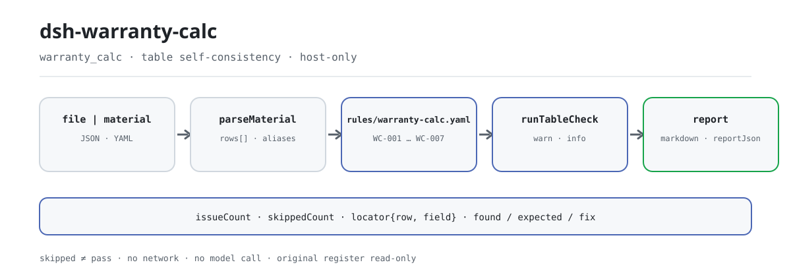

<div align="center">

<picture>
  <source media="(prefers-color-scheme: dark)" srcset="docs/assets/dsh-warranty-calc-flow-dark.svg">
  
</picture>

# dsh-warranty-calc

**逐条指出质保索赔台账里的算术与期限差异——哪一行、哪一栏、差什么。**

面向合同管理与质保结算的纯主机端核对插件：不用懂命令行，不改原件、不联网、不调模型；Excel 可先转成 JSON/YAML（对话里也能代转）再交给它。

[安装](#三步上手) · [配置](#配置) · [FAQ](#faq) · [简体中文](README.md) · [English](README.en.md) · [Español](README.es.md) · [Português](README.pt.md) · [हिन्दी](README.hi.md)

[](LICENSE)
[](#兼容性)
[](https://www.npmjs.com/package/dsh-warranty-calc)
[](https://github.com/PerryLink/dsh-warranty-calc/actions/workflows/ci.yml)
[](#兼容性)

[](https://github.com/PerryLink/dsh-warranty-calc/stargazers)
[](https://www.npmjs.com/package/dsh-warranty-calc)
[](https://dshfind.com/plugins/PerryLink/dsh-warranty-calc?ref=badge)
[](https://securityscorecards.dev/viewer/?uri=github.com/PerryLink/dsh-warranty-calc)
[](https://dsh.market/)
[](https://gitee.com/perrylink/dsh-warranty-calc)

```sh
dsh plugin --profile <name> add dsh-warranty-calc
```

</div>

<sub>社区插件，与 DeepSeek 官方无关。唯一仓库：<https://github.com/PerryLink/dsh-warranty-calc>（Gitee 为镜像）。</sub>

## 它是什么

`dsh-warranty-calc` 读取一份质保索赔台账——经销商表头加每笔索赔一行——核对这份台账自身的算术与期限自洽：每笔索赔是否记录了索赔单号或配件名称、索赔日期是否落在台账写明的质保期截止日之内、索赔时里程是否可解析为数值且不超过台账写明的质保里程、索赔金额是否等于数量乘单价、销售日期是否不晚于索赔日期、索赔单号是否重复。

它只列出材料内部能逐条指认的差异，并给出定位（第几行、哪一栏）、期望与修法；不判断索赔是否应当受理、故障是否属于质保范围，也不判合规、不认定责任，更不替代审核人。纯主机端、零依赖、不联网、不调模型，原件只读不改。

## 三步上手

1. **安装**（npm 已发布）：

   ```sh
   dsh plugin --profile <name> add dsh-warranty-calc
   ```

2. **确认挂载**：

   ```sh
   dsh --profile <name> --dump-config | grep 'dsh-warranty-calc'
   ```

3. **跑一次**：把台账（JSON/YAML）通过 `file` 或 `material` 交给 `warranty_calc` 工具。最小输入：

   ```json
   {"rows":[{"数量":"2","单价":"180","索赔金额":"400"}]}
   ```

   返回的第一条 `WC-005` 会写明第 1 行 `claimAmount` 填报 400，而 2 × 180 = 360。

**卸载**：`dsh plugin --profile <name> remove dsh-warranty-calc`（或从 profile patch 删掉该行）。

仓库自带可复跑的 quickstart（脚本导入 `lib/index.mjs`，先构建）：

```sh
pnpm run build
node samples/quickstart/run.mjs
```

样例在 `samples/quickstart/input/`，期望摘要见 `samples/quickstart/expected/result.json`，终端截图见 `docs/assets/quickstart.png`。

也可以不装插件：在 WorkBuddy / 扣子中搜索「投标合规核对包」（本检查是其中一项；上架以商城为准）。

## 核心能力

工具注册为 `warranty_calc`：读取一份索赔台账，套用一份版本化规则库，返回一份报告。

- **七条规则一次跑完** —— `WC-001`–`WC-007` 覆盖最低可追溯信息、质保期内的日期窗口、里程可解析、里程上限、配件金额算式、销售/索赔日期先后、索赔单号重复；规则库版本化在 `rules/warranty-calc.yaml`。
- **每条发现都能落到行与栏** —— 报告给出 `ruleId`、`severity`、`locator.row` / `locator.field`、`found`、`expected`、`fix`，只列差异，不下定性结论。
- **失败不静默** —— 无法执行的检查逐条进入 `skipped` 并写明原因；缺少必填列的规则自报 `skipped`，不会假装通过。
- **规则是数据** —— 替换 `rules/*.yaml` 即可切换规则集，无需改 TypeScript；加载期校验引文完整性与严重级上限。
- **纯主机、零依赖** —— 不联网、不调模型、无原生代码；单次调用只读你给的材料。
- **可并发** —— 工具声明 `isConcurrencySafe`，一批台账可以并行核对，不共享会话状态。

| 规则 | 核对什么 | 严重级 | 依据类型 |
|---|---|---|---|
| `WC-001` | 索赔记录了索赔单号或配件名称 | warn | direct |
| `WC-002` | 索赔日期落在台账写明的质保期截止日之内 | info | local |
| `WC-003` | 索赔时里程可解析为数值 | warn | principle |
| `WC-004` | 索赔时里程不超过台账写明的里程上限 | info | local |
| `WC-005` | 索赔金额等于数量 × 单价 | warn | direct |
| `WC-006` | 销售日期不晚于索赔日期 | warn | principle |
| `WC-007` | 索赔单号在台账内不重复 | warn | principle |

依据类型：`direct` = 条款直接规定；`principle` = 由原则性条款推论（`derived-from-principle`，严重级封顶 `warn`）；`local` = 本机构配置口径（`institutional-configuration`，封顶 `info`）。

### 示例

下面这条是插件对 `WC-005` 夹具的真实输出，不是示意图。

**工具** `warranty_calc`

**输入**

```json
{"rows":[{"数量":"2","单价":"180","索赔金额":"400"}]}
```

**输出**

```json
{
  "id": "dsh-warranty-calc.WC-005.41a857ae",
  "ruleId": "WC-005",
  "severity": "warn",
  "locator": {
    "column": "claimAmount",
    "row": 1
  },
  "found": "第 1 行「claimAmount」填报 400，而 2 × 180 = 360",
  "expected": "「claimAmount」应等于 quantity × unitPrice",
  "fix": "核对是否抄错或漏改；本条只做算术核对，不判断各因子是否正确",
  "basis": "《家用汽车产品修理更换退货责任规定》（市场监管总局令第43号（2021 年 7 月 22 日公布，自 2022 年 1 月 1 日起施行）） 第十九条（免费修理，包括免除工时费和材料费）：「家用汽车产品在包修期内出现质量问题或者易损耗零部件在其质量保证期内出现质量问题的，消费者可以凭三包凭证选择修理者免费修理（包括免除工时费和材料费）。」"
}
```

*Observed from `dsh-warranty-calc/tests/fixtures/WC-005/WC-005-unsafe.json`*

另一条真实样例来自 quickstart：

```text
$ node samples/quickstart/run.mjs
warranty_calc: 1 issue(s) — error 0, warn 1, info 0
skipped: 1
```

*Observed from `samples/quickstart/expected/result.json`*

## 依据的标准

| 文件 | 文号 | 引用它的规则 |
|---|---|---|
| 《家用汽车产品修理更换退货责任规定》 | 市场监管总局令第43号（2021 年 7 月 22 日公布，自 2022 年 1 月 1 日起施行） | WC-001, WC-003, WC-005, WC-006, WC-007 |
| 各厂商质保政策与三包规定（本机构配置） | 无统一标准（本条依据为台账写明的质保期） | WC-002 |
| 各厂商质保政策（本机构配置） | 无统一标准（本条依据为台账写明的里程上限） | WC-004 |

**边界：** 本插件核对一份 **质保索赔台账** 的算术与期限自洽——每笔索赔是否记录其索赔单号或配件名称，索赔日期是否落在台账写明的质保期截止日之内，里程是否可解析且不超过台账写明的里程上限，索赔金额是否等于数量 × 单价，销售日期是否不晚于索赔日期，以及索赔单号是否不重复。它**不**判定索赔是否应当受理、故障是否属于质保范围，或是否由不当使用或正常磨损造成。

> ### ⚠️ 质保政策由厂商制定，本规则库不假装引用其中任何一条
>
> 质保期长度、里程上限、工时费率与免赔额，由**各厂商的质保政策**以及相应产品类别的三包规定确定。**不存在统一标准**，因此每条规则的 `basis` 都如实写明这一点，并停留在 `warn` 或 `info`。
>
> 在相信任何一条发现之前，有三项后果值得了解：
>
> - **本插件从不推算质保截止日期。** 它不计算「销售日期 + 36 个月」，因为每个月的天数不同，而且质保期可能从交车或注册登记起算，而不是从销售起算——算出来的日期看起来精确，却可能是错的。**你应当依据适用的政策自己算出日期，并填入「质保期截止日」栏**，`WC-002` 拿它来比对。
> - **`WC-004` 的里程上限同样来自台账。** 不内置任何数字，一条发现意味着「超过你记录的上限」，从不意味着「已出保」——时间与里程是**两项独立的限制，以先到者为准**，而超过其中任一项之后如何处理，各厂商政策并不相同。
> - **`WC-005` 只覆盖配件。** 真实的索赔金额往往会加上工时与材料、再减去免赔额，而本台账为这些项目设有单独的栏。按「配件 + 工时 − 免赔额」结算的台账会报出差异；请把 `resultField` 改为指向配件金额栏，或停用该条规则。
>
> **规则库的 `excerpt` 只放两种内容：已取得的逐字引文，或明确写明「本条依据为本机构配置的口径，不存在可引用的标准条文；本规则库不伪造引文」。** `WC-001`、`WC-003`、`WC-005`、`WC-006`、`WC-007` 的 `excerpt` 已于 2026-10-07 换为逐字引文（核验记录见 `rules/evidence/`）；`WC-002` 与 `WC-004` 属本机构配置口径，`kind: institutional-configuration`，严重级封顶 `info`。

## 配置

全部可调参数都在 `src/config.ts` 的 Schemastery schema 中，改 `cordis.yml` 即可生效，无需改代码；逐条阈值在 `rules/` 下的规则库文件里。

| 键 | 类型 | 默认值 | 说明 |
|---|---|---|---|
| `rulesFile` | string | `rules/warranty-calc.yaml` | 规则库文件路径，相对插件包根目录 |
| `disabledRules` | string[] | `[]` | 要停用的规则 id 列表；每条都会出现在 `skipped` 中 |
| `onlyRules` | string[] | `[]` | 只执行这些规则 id；留空表示执行全部规则 |
| `skipNotes` | string | `""` | 附加到每条 `skipped` 说明后的备注 |
| `timeoutMs` | number | `120000` | 工具协作式超时预算（毫秒） |

规则级参数值得知道的几条：

- `WC-002` 需要台账的「质保期截止日」/ `warrantyEndAt` 栏；没有该栏时规则自报 `skipped`。插件从不按月数推算这个日期。
- `WC-004` 需要台账的 `warrantyMiles`；不内置任何里程数字。
- `WC-005` 的 `resultField` / `factorFields` / `tolerance` 是配件算式；若本机构按「配件 + 工时 − 免赔额」结算，请把它指向配件金额栏。

profile patch 覆盖示例：

```yaml
- insert:
    - id: dsh-warranty-calc
      name: dsh-warranty-calc
      config:
        disabledRules: [WC-005]
        skipNotes: 本机构 2026 版质保政策
```

## 材料格式

工具接受 JSON 或 YAML：

```yaml
dealer: 某某服务站
manufacturer: 某某厂商
policyVersion: 2026 版质保政策
rows:
  - { 索赔单号: SP-2026-0018, 配件名称: 前制动片, 销售日期: 2024-03-10,
      索赔时里程: '48600', 质保期月数: '36', 质保里程: '100000',
      质保期截止日: 2027-03-09, 索赔日期: 2026-03-05,
      数量: '2', 单价: '180', 索赔金额: '360', 处理结论: 同意索赔 }
```

列名匹配不区分大小写，并忽略空格、下划线与连字符；台账自己的列名会被保留，因此发现会直接写出它读到的栏目。字段在读取层是可选的，由检查引擎校验，所以部分导出的材料会产生「缺项」类差异，而不是让程序崩溃。

## 规则来源

规则数据与代码分离，位于 `rules/warranty-calc.yaml`。因为质保政策是厂商文件而不是统一标准，规则库的 `basis` 会明确写出这一点，而不是硬引一个标准。加载期仍然强制每条规则带 document / number / clause / excerpt / kind / source，`excerpt` 必须是真实逐字引文且不少于八个字符；依据仅为原则性条款（`kind: derived-from-principle`，严重级上限 `warn`）或本机构配置（`kind: institutional-configuration`，上限 `info`）的检查不得标为 `error`。夸大依据的规则库会在加载期失败，而不会产出一份看起来很有底气的报告。

核验中确认的边界与「刻意没有作出的结论」见 `rules/evidence/` 目录。

## FAQ

<details>
<summary>台账没有填质保期截止日，索赔日期的核对就直接通过了？</summary>

不会。质保期截止日栏为空时，`WC-002` 报告自己进入 `skipped`：它不假定任何期限，也不用销售日期推算一个。该栏填了以后，它只核对索赔日期是否落在你写的销售日期与截止日之间；报了差异只表示与你写在台账里的期限不一致，不表示索赔已超保。

</details>

<details>
<summary>索赔金额与数量乘单价对不上，能查出来吗？</summary>

能。`WC-005` 核对 `claimAmount` 是否等于 `quantity` × `unitPrice`，超出 0.01 的容差即报出该行。它只覆盖配件金额：若本机构按「配件 + 工时 − 免赔额」结算（台账另有 `laborHours`、`laborRate`、`deductible` 三栏），本条会报差异——请把 `resultField` 指向配件金额栏，或停用本条。它不判断单价是否合理，也不判断该配件是否应当更换。

</details>

<details>
<summary>索赔时里程写的是 `48,600 公里`，还读得出来吗？超过上限又会怎样？</summary>

读得出来。`WC-003` 取其中的数字部分，`48600` 与 `48,600 公里` 都能解析；只有解析不了的里程才报出，它不判断里程是否超过上限。做这个比较的是 `WC-004`：它只拿台账写明的 `warrantyMiles` 上限相比，不内置任何里程数，命中只表示「超过你写在台账里的上限」，不表示索赔已超保——时间与里程是两个独立维度，以先到者为准。

</details>

<details>
<summary>同一个索赔单号在两行各出现一次。</summary>

`WC-007` 会报出重复的 `claimNo`，比较时忽略空白字符，因为重复会让索赔金额合计被重复计算，也让厂商核销时对不上行。同一笔索赔分多行登记不同配件是正常的：请在配件名称栏加以区分。

</details>

<details>
<summary>某行的索赔单号和配件名称都没有填。</summary>

`WC-001` 只在 `claimNo` 与 `partName` 一个都没填时报出该行，填了其中一个即可。它只核对最低可追溯信息是否填写，不判断该索赔是否在质保范围内、是否应当受理。

</details>

<details>
<summary>销售日期比索赔日期还晚。</summary>

`WC-006` 拿台账里这两个日期相比，`saleDate` 晚于 `claimDate` 时报出该行。起算日取自你填的销售日期栏：本条所引条款写的是发票日与交付日两个起算点，本条不替你选定，实际起算以厂商承诺为准。日期解析不了会单独报出，不会静默跳过。

</details>

## 安全边界

- **原件只读。** 工具只读取 `file` 指向的文件或 `material` 内联文本；`package.json` 的 demo 声明是 `reads: ["用户指定的材料文件"]`、`writes: []`、`network: false`、`external: []`。它不改动原件，也不自行落盘报告。
- **不联网、不调模型。** 纯 ESM、零依赖、无原生代码；报告完全由本地规则与输入计算得出。
- **不作出定性结论。** 报告只列差异，并始终带固定免责声明；测试断言渲染结果不含「合规 / 违规 / 通过验收」这类定性措辞，也不含对责任或质保范围的判断。
- **引文纪律是加载期的。** 每条规则必须有 document / number / clause / excerpt / kind / source；`excerpt` 必须是真实逐字引文且不少于八个字符；本机构配置口径不得标 `error`。不满足即加载失败。
- **失败关闭。** 规则库路径解析失败会抛出并列出所有尝试过的位置，不会静默换用另一份规则库；规则库校验失败则整次调用失败。
- **注册即 effect。** 工具注册返回 disposer；卸载或热重载即撤销。

## 已知限制

- **质保政策由厂商制定，没有统一标准。** 质保期长度、里程上限、工时费率与免赔额因厂商、品类而异；规则库的 `basis` 逐条写明这一点，严重级只到 `warn` / `info`。
- **从不推算质保截止日。** 不计算「销售日期 + N 个月」：月有长短，起算点可能是发票日或交付日，而且三包有效期与包修期是两个期限；这些理由均据《家用汽车产品修理更换退货责任规定》第十八条逐字核对，见 `rules/evidence/`。截止日应由使用方按政策算出后写入台账。
- **`WC-004` 的上限来自台账。** 不内置任何里程数字；命中只表示「超过你写在台账里的上限」，不表示「已出保」——时间与里程是两个独立限制，以先到者为准。
- **`WC-005` 只覆盖配件金额。** 按「配件 + 工时 − 免赔额」结算的台账会报差异；请重指 `resultField` 或停用该条。
- **日期解析格式有限。** 接受 `2026-03-05` 或 `2026-03-05 09:30`；`2026年3月5日` 会被有意报为无法解析，不静默转换。
- **不判定受理、责任与质保范围。** 那需要技术人员鉴定并对照厂商质保政策，是索赔审核的判断。
- **本规则库最高只到 `warn`。** 七条规则没有任何 `error` 级发现；本地配置口径封顶 `info`，原则性推论封顶 `warn`。
- **时间按输入字符串的墙上时钟计算**，不做时区换算。

## 故障排查

- **插件装上了但工具不出现**：确认 `main` 指向 `lib/index.mjs` 且 `pnpm run build` 已生成该文件；`main` 写错会让加载器静默跳过该条目。
- **`dsh plugin add` 报版本不兼容**：peer 范围覆盖 `0.1.x` 与 `0.2.x`；若运行时在其之外，可显式豁免：`dsh plugin --profile <name> allow-version <包名@版本> --dsh-version <runtime> --accept-risk`
- **某条规则没有执行**：查看 `skipped` 数组，其中写明了规则 id 与原因。
- **`WC-002` 报告自己 skipped**：台账没有填质保期截止日；插件不会替你算一个。
- **`WC-002` 在你认为仍在质保期内时命中**：台账写明的截止日与索赔日期不一致。请按适用政策复核截止日是怎么算出来的。
- **`WC-004` 在你认为仍在质保期内时命中**：索赔时里程超过你记录的上限——但时间与里程是两个独立限制，这条命中本身不表示索赔已出保。
- **`WC-005` 在正确的结算上命中**：金额很可能含了工时与免赔额；把 `resultField` 指向配件金额栏，或停用该条。
- **`check` 报 `manifest-peers` 失败**：静态检查器比对的是一份早于 0.2 世代的硬编码 peer 范围；安装期的 peer 校验以运行时为准。这是 `dsh-plugin-dev` 的已知上游问题。
- **时间看起来偏移**：全部计算都是对输入字符串做墙上时钟运算，不做时区换算。

## 与其他 DSH 插件的互操作性

本插件只注册一个工具 `warranty_calc`，不注册事件监听器、服务键、客户端 slot 或 `webServer` 路由，因此不会与其他插件争抢这些表面：

- **工具面**：唯一注册项是 `warranty_calc`；工具注册经 `ctx.tools.register` 返回 disposer，卸载或热重载即撤销。
- **无服务键 / 无 slot**：不提供 service，也不注册客户端 slot key，不参与 `shadows-shipped-ui` 座位争抢。
- **无 HTTP 路由**：不注册任何 `webServer` 前缀。
- **无 patch 层冲突**：组合包的 `cordis.patch.yml` 只 `insert` 自己那一行，从不覆写内置行的 `config`。
- **无全局改写**：不改原型、不改写 `process.env`、不替换全局 fetch dispatcher。
- **并发安全**：工具声明 `isConcurrencySafe`，多份台账可并行核对，不共享可变的会话状态。

## 兼容性

| 项目 | 状态 |
|---|---|
| Harness | 对等版本范围 `>=0.1.2-rc.1 <0.2.0 \|\| >=0.2.0-0 <0.3.0` —— 已实测同时接受 `0.2.0-rc.2` 与 `0.2.1-rc.2`。`engines.dsh` 声明为 `>=0.2.1-0 <0.3.0`，0.2.1 起由宿主单独裁决 |
| Node | `^22.19.0 \|\| >=24.0.0` |
| 平台 | 全平台（纯 ESM；无原生代码、无联网、不调用模型） |
| 工具模式 | `native` / `ptc` 均可；批量核对一批索赔时建议 `ptc`，schema 成本只付一次 |

## 生态与质量

- [Gitee 镜像](https://gitee.com/perrylink/dsh-warranty-calc)（同步镜像，以 GitHub 为准）
- [dshfind 插件页](https://dshfind.com/plugins/PerryLink/dsh-warranty-calc)（安装量与排名）
- [OpenSSF Scorecard 报告](https://securityscorecards.dev/viewer/?uri=github.com/PerryLink/dsh-warranty-calc)（由 [.github/workflows/scorecard.yml](.github/workflows/scorecard.yml) 驱动）
- [DSH Market](https://dsh.market/)（已上架）
- [npm 包页](https://www.npmjs.com/package/dsh-warranty-calc)（版本与下载量）
- [按材料选核查器](https://perrylink.github.io/zh/checkers/choose/)（家族选型索引）

## 开发

```sh
pnpm install
pnpm run typecheck   # tsc --noEmit
pnpm test            # vitest，共享表格插件套件 + 成对夹具
pnpm run build       # tsdown -> lib/index.mjs + lib/index.d.mts
pnpm run verify:self-contained
pnpm run check:lockfile
pnpm run check:readmes
pnpm pack
node ../scripts/sync-shared.mjs dsh-warranty-calc
```

插件是 **data-only** 的：`src/model.ts` 声明表结构与字段别名，共享套件提供读取器与检查引擎，规则库声明每一条检查。第 9 项把 `../_shared` 的共享件同步进 `src/shared/`；每次改动共享件后都要重跑。quickstart 见 `samples/quickstart/`。

README 配图由 [`scripts/gen-readme-assets.py`](scripts/gen-readme-assets.py) 程序化生成（Python + Pillow），可重复执行：

```sh
python scripts/gen-readme-assets.py
```

Topics：`dsh`, `dsh-plugin`, `deepseek-harness`, `deepseek`, `cordis`, `warranty`, `calc`

## 家族与致谢

本项目是 [PerryLink](https://github.com/PerryLink) 维护的 DeepSeek Harness 插件家族成员（全部 Apache-2.0）。如果这个插件帮到了你，**给个 star**——它不解锁任何功能，但会让下一个人更容易找到它。

- [@PerryLink](https://github.com/PerryLink) —— 创建者与维护者：质保索赔规则库、表格检查引擎、`warranty_calc` 工具、成对夹具与五语文档。

<details>
<summary>展开全部插件</summary>

| 插件 | 状态 |
|---|---|
| **[dsh-aqua-input-check](https://github.com/PerryLink/dsh-aqua-input-check)** |  |
| **[dsh-archive-check](https://github.com/PerryLink/dsh-archive-check)** |  |
| **[dsh-auto-review](https://github.com/PerryLink/dsh-auto-review)** |  |
| **[dsh-autotier](https://github.com/PerryLink/dsh-autotier)** | 🧊 已冻结 — 见仓库 README |
| **[dsh-bid-ca-precheck](https://github.com/PerryLink/dsh-bid-ca-precheck)** |  |
| **[dsh-bid-qual-check](https://github.com/PerryLink/dsh-bid-qual-check)** |  |
| **[dsh-cert-mcp](https://github.com/PerryLink/dsh-cert-mcp)** | 🧊 已冻结 — 见仓库 README |
| **[dsh-checkpoint-rewind](https://github.com/PerryLink/dsh-checkpoint-rewind)** |  |
| **[dsh-click](https://github.com/PerryLink/dsh-click)** |  |
| **[dsh-composer-history](https://github.com/PerryLink/dsh-composer-history)** |  |
| **[dsh-contract-stance](https://github.com/PerryLink/dsh-contract-stance)** |  |
| **[dsh-customs-doc-check](https://github.com/PerryLink/dsh-customs-doc-check)** |  |
| **[dsh-data-quality](https://github.com/PerryLink/dsh-data-quality)** | 🧊 已冻结 — 见仓库 README |
| **[dsh-demurrage-ledger](https://github.com/PerryLink/dsh-demurrage-ledger)** |  |
| **[dsh-doublecheck](https://github.com/PerryLink/dsh-doublecheck)** |  |
| **[dsh-drill-script-check](https://github.com/PerryLink/dsh-drill-script-check)** |  |
| **[dsh-eia-guide-check](https://github.com/PerryLink/dsh-eia-guide-check)** |  |
| **[dsh-emergency-plan](https://github.com/PerryLink/dsh-emergency-plan)** |  |
| **[dsh-essay-rubric-check](https://github.com/PerryLink/dsh-essay-rubric-check)** |  |
| **[dsh-evidence-check](https://github.com/PerryLink/dsh-evidence-check)** |  |
| **[dsh-export-ctl-check](https://github.com/PerryLink/dsh-export-ctl-check)** |  |
| **[dsh-fast](https://github.com/PerryLink/dsh-fast)** |  |
| **[dsh-fmea-table-check](https://github.com/PerryLink/dsh-fmea-table-check)** |  |
| **[dsh-forecast-penalty](https://github.com/PerryLink/dsh-forecast-penalty)** |  |
| **[dsh-fund-research](https://github.com/PerryLink/dsh-fund-research)** |  |
| **[dsh-github](https://github.com/PerryLink/dsh-github)** |  |
| **[dsh-gongwen-flow-check](https://github.com/PerryLink/dsh-gongwen-flow-check)** |  |
| **[dsh-gongwen-word-check](https://github.com/PerryLink/dsh-gongwen-word-check)** |  |
| **[dsh-guard-plan-qc](https://github.com/PerryLink/dsh-guard-plan-qc)** |  |
| **[dsh-hazchem-check](https://github.com/PerryLink/dsh-hazchem-check)** |  |
| **[dsh-hazplan-check](https://github.com/PerryLink/dsh-hazplan-check)** |  |
| **[dsh-hidden-risk-map](https://github.com/PerryLink/dsh-hidden-risk-map)** |  |
| **[dsh-hs-classify](https://github.com/PerryLink/dsh-hs-classify)** |  |
| **[dsh-icd-rule-check](https://github.com/PerryLink/dsh-icd-rule-check)** |  |
| **[dsh-industry-research](https://github.com/PerryLink/dsh-industry-research)** |  |
| **[dsh-lawcite-adapter](https://github.com/PerryLink/dsh-lawcite-adapter)** |  |
| **[dsh-laya](https://github.com/PerryLink/dsh-laya)** |  |
| **[dsh-lc-doc-check](https://github.com/PerryLink/dsh-lc-doc-check)** |  |
| **[dsh-learning-gap-check](https://github.com/PerryLink/dsh-learning-gap-check)** |  |
| **[dsh-library](https://github.com/PerryLink/dsh-library)** |  |
| **[dsh-local-ai](https://github.com/PerryLink/dsh-local-ai)** |  |
| **[dsh-lsp-actions](https://github.com/PerryLink/dsh-lsp-actions)** |  |
| **[dsh-mask](https://github.com/PerryLink/dsh-mask)** |  |
| **[dsh-mcp-panel](https://github.com/PerryLink/dsh-mcp-panel)** |  |
| **[dsh-medrec-qc](https://github.com/PerryLink/dsh-medrec-qc)** |  |
| **[dsh-memento](https://github.com/PerryLink/dsh-memento)** | 🧊 已冻结 — 见仓库 README |
| **[dsh-nsfc-form-check](https://github.com/PerryLink/dsh-nsfc-form-check)** |  |
| **[dsh-nurse-record-check](https://github.com/PerryLink/dsh-nurse-record-check)** |  |
| **[dsh-observe](https://github.com/PerryLink/dsh-observe)** |  |
| **[dsh-origin-rvc-check](https://github.com/PerryLink/dsh-origin-rvc-check)** |  |
| **[dsh-ota-review-check](https://github.com/PerryLink/dsh-ota-review-check)** |  |
| **[dsh-output-styles](https://github.com/PerryLink/dsh-output-styles)** |  |
| **[dsh-paper-doc-adapter](https://github.com/PerryLink/dsh-paper-doc-adapter)** |  |
| **[dsh-permission-rules](https://github.com/PerryLink/dsh-permission-rules)** |  |
| **[dsh-permit-report-check](https://github.com/PerryLink/dsh-permit-report-check)** |  |
| **[dsh-pipeline-check](https://github.com/PerryLink/dsh-pipeline-check)** |  |
| **[dsh-pleading-draft](https://github.com/PerryLink/dsh-pleading-draft)** |  |
| **[dsh-plugin-doctor](https://github.com/PerryLink/dsh-plugin-doctor)** | 🚫 已退役（仓库已归档） |
| **[dsh-plugin-guide](https://github.com/PerryLink/dsh-plugin-guide)** |  |
| **[dsh-plugin-kit](https://github.com/PerryLink/dsh-plugin-kit)** | 🚫 已退役（仓库已归档） |
| **[dsh-plugin-upgrade](https://github.com/PerryLink/dsh-plugin-upgrade)** | 🚫 已退役（仓库已归档） |
| **[dsh-policy-brief-draft](https://github.com/PerryLink/dsh-policy-brief-draft)** |  |
| **[dsh-power-loss-split](https://github.com/PerryLink/dsh-power-loss-split)** |  |
| **[dsh-power-ticket-check](https://github.com/PerryLink/dsh-power-ticket-check)** |  |
| **[dsh-ppap-check](https://github.com/PerryLink/dsh-ppap-check)** |  |
| **[dsh-protest-deadline](https://github.com/PerryLink/dsh-protest-deadline)** |  |
| **[dsh-railway-window](https://github.com/PerryLink/dsh-railway-window)** |  |
| **[dsh-repair-order-qc](https://github.com/PerryLink/dsh-repair-order-qc)** |  |
| **[dsh-research-report](https://github.com/PerryLink/dsh-research-report)** |  |
| **[dsh-review-reply-check](https://github.com/PerryLink/dsh-review-reply-check)** |  |
| **[dsh-rulefile-check](https://github.com/PerryLink/dsh-rulefile-check)** |  |
| **[dsh-safety-brief-check](https://github.com/PerryLink/dsh-safety-brief-check)** |  |
| **[dsh-score](https://github.com/PerryLink/dsh-score)** | 🧊 已冻结 — 见仓库 README |
| **[dsh-session-sync](https://github.com/PerryLink/dsh-session-sync)** |  |
| **[dsh-site-log-check](https://github.com/PerryLink/dsh-site-log-check)** |  |
| **[dsh-skill-pack-security](https://github.com/PerryLink/dsh-skill-pack-security)** |  |
| **[dsh-soe-decision-check](https://github.com/PerryLink/dsh-soe-decision-check)** |  |
| **[dsh-soilwater-check](https://github.com/PerryLink/dsh-soilwater-check)** |  |
| **[dsh-sop-sync-check](https://github.com/PerryLink/dsh-sop-sync-check)** |  |
| **[dsh-spc-gbt-adapter](https://github.com/PerryLink/dsh-spc-gbt-adapter)** |  |
| **[dsh-talk](https://github.com/PerryLink/dsh-talk)** |  |
| **[dsh-tender-extract](https://github.com/PerryLink/dsh-tender-extract)** |  |
| **[dsh-tender-matrix](https://github.com/PerryLink/dsh-tender-matrix)** |  |
| **[dsh-test-drive](https://github.com/PerryLink/dsh-test-drive)** |  |
| **[dsh-ticktick](https://github.com/PerryLink/dsh-ticktick)** | 🚫 已退役（仓库已归档） |
| **[dsh-translate](https://github.com/PerryLink/dsh-translate)** |  |
| **[dsh-warranty-calc](https://github.com/PerryLink/dsh-warranty-calc)** |  |
| **[dsh-budget](https://github.com/PerryLink/dsh-budget)** | 🧊 已冻结 — 见仓库 README |
| **[dsh-claude-move](https://github.com/PerryLink/dsh-claude-move)** | 🧊 已冻结 — 见仓库 README |
| **[dsh-defend](https://github.com/PerryLink/dsh-defend)** | 🧊 已冻结 — 见仓库 README |
| **[dsh-draw](https://github.com/PerryLink/dsh-draw)** | 🧊 已冻结 — 见仓库 README |
| **[dsh-reach](https://github.com/PerryLink/dsh-reach)** | 🧊 已冻结 — 见仓库 README |
| **[dsh-background-agents](https://github.com/PerryLink/dsh-background-agents)** | 🚫 已退役（仓库已归档） |
| **[dsh-session-pin](https://github.com/PerryLink/dsh-session-pin)** | 🚫 已退役（仓库已归档） |
| **[dsh-team-rooms](https://github.com/PerryLink/dsh-team-rooms)** | 🚫 已退役（仓库已归档） |

</details>

## License

[LICENSE](LICENSE)（Apache License 2.0）© 2026 dsh-warranty-calc contributors

<p align="center"><sub>Apache-2.0 · 社区插件，与 DeepSeek 无关。</sub></p>
