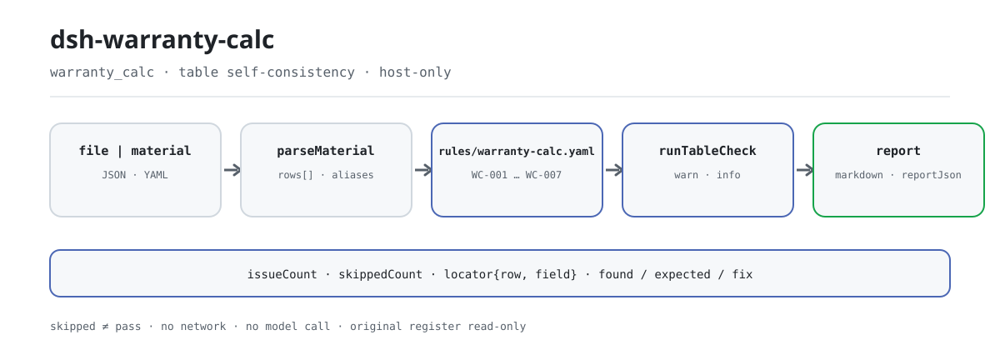

<div align="center">

<picture>
  <source media="(prefers-color-scheme: dark)" srcset="docs/assets/dsh-warranty-calc-flow-dark.svg">
  
</picture>

# dsh-warranty-calc

**Apontar, reclamação por reclamação, cada incoerência aritmética e de prazo no registo de reclamações de garantia: que linha, que coluna e o que difere.**

Um verificador local para gestão de contratos e liquidação de garantias: não é preciso saber usar a linha de comandos, o original nunca é alterado, não há rede nem chamada ao modelo. O Excel pode ser convertido antes para JSON/YAML (também no chat, se a plataforma o permitir).

[Instalação](#instalação-em-três-passos) · [Configuração](#configuração) · [FAQ](#faq) · [简体中文](README.md) · [English](README.en.md) · [Español](README.es.md) · [Português](README.pt.md) · [हिन्दी](README.hi.md)

[](LICENSE)
[](#compatibilidade)
[](https://www.npmjs.com/package/dsh-warranty-calc)
[](https://github.com/PerryLink/dsh-warranty-calc/actions/workflows/ci.yml)
[](#compatibilidade)

[](https://github.com/PerryLink/dsh-warranty-calc/stargazers)
[](https://www.npmjs.com/package/dsh-warranty-calc)
[](https://dshfind.com/plugins/PerryLink/dsh-warranty-calc?ref=badge)
[](https://securityscorecards.dev/viewer/?uri=github.com/PerryLink/dsh-warranty-calc)
[](https://dsh.market/)
[](https://gitee.com/perrylink/dsh-warranty-calc)

```sh
dsh plugin --profile <name> add dsh-warranty-calc
```

</div>

<sub>Plugin da comunidade, sem relação com a DeepSeek. Repositório canónico: <https://github.com/PerryLink/dsh-warranty-calc> (o Gitee é um espelho).</sub>

## O que é

`dsh-warranty-calc` lê um registo de reclamações de garantia —o cabeçalho do concessionário mais uma linha por reclamação— e verifica a aritmética e a coerência de prazos desse mesmo registo: se cada reclamação anota o seu número de reclamação ou o nome da peça, se a data da reclamação cai dentro da data de fim de garantia que o registo declara, se a quilometragem na reclamação é analisável como número e não excede o limite de quilometragem que o registo declara, se o valor reclamado é igual a quantidade × preço unitário, se a data de venda não é posterior à data da reclamação e se não há números de reclamação repetidos.

Devolve apenas as diferenças que consegue apontar dentro do material, com a localização (linha, coluna), o esperado e a correção; não decide se uma reclamação deve ser aceite ou se uma avaria está coberta, não emite juízos de conformidade nem de responsabilidade, nem substitui o revisor. É local, sem dependências, sem rede e sem chamada ao modelo; o original é apenas de leitura.

## Instalação em três passos

1. **Instalar** (publicado no npm):

   ```sh
   dsh plugin --profile <name> add dsh-warranty-calc
   ```

2. **Confirmar que monta**:

   ```sh
   dsh --profile <name> --dump-config | grep 'dsh-warranty-calc'
   ```

3. **Executar uma vez**: entregue o registo (JSON/YAML) à ferramenta `warranty_calc` através de `file` ou `material`. Entrada mínima:

   ```json
   {"rows":[{"数量":"2","单价":"180","索赔金额":"400"}]}
   ```

   O primeiro achado, `WC-005`, indica que a linha 1 declara 400 em `claimAmount` enquanto 2 × 180 = 360.

**Desinstalar**: `dsh plugin --profile <name> remove dsh-warranty-calc` (ou remova a linha do patch do perfil).

O repositório inclui um quickstart repetível (o script importa `lib/index.mjs`, por isso compile primeiro):

```sh
pnpm run build
node samples/quickstart/run.mjs
```

A amostra está em `samples/quickstart/input/`, o resumo esperado em `samples/quickstart/expected/result.json` e uma captura de terminal em `docs/assets/quickstart.png`.

Também pode dispensar a instalação: procure «Tender Compliance Suite» no WorkBuddy / Coze (esta verificação é uma das suas partes; disponibilidade conforme catálogo).

## Capacidades principais

A ferramenta é registada como `warranty_calc`: lê um registo de reclamações, aplica um pacote de regras versionado e devolve um relatório.

- **Sete regras numa passagem** — `WC-001`–`WC-007` cobrem a informação mínima de rastreabilidade, a janela de datas dentro do período de garantia, a analisabilidade da quilometragem, o limite de quilometragem, a aritmética das peças, a ordem venda/reclamação e os números de reclamação duplicados; o pacote de regras é versionado em `rules/warranty-calc.yaml`.
- **Cada achado cai numa linha e numa coluna** — o relatório leva `ruleId`, `severity`, `locator.row` / `locator.field`, `found`, `expected` e `fix`; lista diferenças e não emite veredicto.
- **A falha nunca é silenciosa** — toda a verificação que não pode correr entra em `skipped` com o motivo; uma regra à qual falta a coluna obrigatória declara-se a si mesma em vez de passar.
- **As regras são dados** — substituir `rules/*.yaml` muda o conjunto de regras sem tocar em TypeScript; o carregador valida a citação e o teto de severidade.
- **Local e sem dependências** — sem rede, sem chamada ao modelo, sem código nativo; uma chamada lê apenas o material que você entrega.
- **Seguro em concorrência** — a ferramenta declara `isConcurrencySafe`, pelo que vários registos podem ser verificados em paralelo sem estado de sessão partilhado.

| Regra | O que verifica | Severidade | Tipo de base |
|---|---|---|---|
| `WC-001` | a reclamação anota o número ou o nome da peça | warn | direct |
| `WC-002` | a data da reclamação cai dentro do fim de garantia declarado | info | local |
| `WC-003` | a quilometragem na reclamação é analisada como número | warn | principle |
| `WC-004` | a quilometragem não excede o limite declarado | info | local |
| `WC-005` | o valor reclamado é igual a quantidade × preço unitário | warn | direct |
| `WC-006` | a data de venda não é posterior à da reclamação | warn | principle |
| `WC-007` | os números de reclamação não se repetem | warn | principle |

Tipos de base: `direct` = a cláusula estabelece o requisito diretamente; `principle` = inferido de uma cláusula de princípio (`derived-from-principle`, severidade máxima `warn`); `local` = configuração institucional (`institutional-configuration`, máximo `info`).

### Exemplos

A saída detalhada abaixo é a saída real do plugin sobre o fixture `WC-005`, não uma simulação.

**Ferramenta** `warranty_calc`

**Entrada**

```json
{"rows":[{"数量":"2","单价":"180","索赔金额":"400"}]}
```

**Saída**

```json
{
  "id": "dsh-warranty-calc.WC-005.41a857ae",
  "ruleId": "WC-005",
  "severity": "warn",
  "locator": {
    "column": "claimAmount",
    "row": 1
  },
  "found": "第 1 行「claimAmount」填报 400，而 2 × 180 = 360",
  "expected": "「claimAmount」应等于 quantity × unitPrice",
  "fix": "核对是否抄错或漏改；本条只做算术核对，不判断各因子是否正确",
  "basis": "《家用汽车产品修理更换退货责任规定》（市场监管总局令第43号（2021 年 7 月 22 日公布，自 2022 年 1 月 1 日起施行）） 第十九条（免费修理，包括免除工时费和材料费）：「家用汽车产品在包修期内出现质量问题或者易损耗零部件在其质量保证期内出现质量问题的，消费者可以凭三包凭证选择修理者免费修理（包括免除工时费和材料费）。」"
}
```

*Observado em `dsh-warranty-calc/tests/fixtures/WC-005/WC-005-unsafe.json`*

Outra amostra real vem do quickstart:

```text
$ node samples/quickstart/run.mjs
warranty_calc: 1 issue(s) — error 0, warn 1, info 0
skipped: 1
```

*Observado em `samples/quickstart/expected/result.json`*

## Normas que segue

| Documento | Número | Regras que o citam |
|---|---|---|
| Provisions on the Liability for Repair, Replacement and Return of Household Automobile Products | Ordem SAMR n.º 43 (publicada em 22 de julho de 2021, em vigor desde 1 de janeiro de 2022) | WC-001, WC-003, WC-005, WC-006, WC-007 |
| Políticas de garantia de fabricantes e normas das três garantias (configuração institucional) | Sem norma unificada (esta regra baseia-se no período de garantia registado no livro) | WC-002 |
| Políticas de garantia de fabricantes (configuração institucional) | Sem norma unificada (esta regra baseia-se no limite de quilometragem registado no livro) | WC-004 |

**Limite:** este plugin verifica a aritmética e a coerência de prazos de um **registo de reclamações de garantia** — que cada reclamação anote o seu número ou o nome da peça, que a data da reclamação caia dentro da data de fim de garantia declarada, que a quilometragem seja analisável e não exceda o limite declarado, que o valor seja quantidade × preço unitário, que a data de venda não seja posterior à da reclamação e que os números não se repitam. **Não** decide se uma reclamação deve ser aceite, se uma avaria está coberta nem se foi causada por uso indevido ou desgaste normal.

> ### ⚠️ A política de garantia é do fabricante e este pacote não finge citar uma
>
> A duração do período, o limite de quilometragem, as taxas de mão de obra e as franquias são definidos **pela política de garantia de cada fabricante** e pelas normas das três garantias do produto correspondente. **Não existe uma norma unificada**, por isso o `basis` de cada regra diz isso mesmo e fica em `warn` ou `info`.
>
> Há três consequências que vale a pena conhecer antes de confiar num achado:
>
> - **O plugin nunca calcula a data de fim de garantia.** Não calcula «data de venda + 36 meses», porque os meses têm durações diferentes e o período pode começar na entrega ou na matrícula e não na venda: uma data calculada pareceria precisa e poderia estar errada. **Você calcula a data segundo a política aplicável e escreve-a na coluna de fim de garantia (`warrantyEndAt`)**; o `WC-002` compara com ela.
> - **O limite de quilometragem do `WC-004` também vem do livro.** Não há nenhum valor incorporado; um achado significa «acima do limite que você registou», nunca «fora de garantia»: tempo e quilometragem são **limites independentes, o que ocorrer primeiro**, e as políticas diferem no que acontece depois de superar qualquer um deles.
> - **O `WC-005` cobre apenas as peças.** Os valores reais costumam somar mão de obra e materiais e subtrair uma franquia, e este livro tem colunas separadas para isso. Um livro que liquide como «peças + mão de obra − franquia» reportará uma diferença; aponte `resultField` para uma coluna de valor de peças ou desative a regra.
>
> **O `excerpt` do pacote de regras contém apenas uma de duas coisas: uma citação literal obtida, ou a declaração explícita de que a regra se baseia numa configuração institucional e não existe texto de cláusula citável; o pacote nunca inventa uma citação.** Os `excerpt` de `WC-001`, `WC-003`, `WC-005`, `WC-006` e `WC-007` foram substituídos por citações literais em 2026-10-07 (registo de verificação em `rules/evidence/`); `WC-002` e `WC-004` são configurações institucionais com `kind: institutional-configuration` e teto de severidade `info`.

## Configuração

Todos os parâmetros ajustáveis são campos Schemastery de `src/config.ts`, portanto mudam pelo `cordis.yml` sem editar código; os limites por regra ficam no pacote de regras sob `rules/`.

| Chave | Tipo | Padrão | Descrição |
|---|---|---|---|
| `rulesFile` | string | `rules/warranty-calc.yaml` | Caminho do pacote de regras, relativo à raiz do pacote |
| `disabledRules` | string[] | `[]` | Ids de regras a desativar; cada uma aparece em `skipped` |
| `onlyRules` | string[] | `[]` | Executar apenas estas regras; vazio executa todas |
| `skipNotes` | string | `""` | Nota acrescentada a cada motivo de `skipped` |
| `timeoutMs` | number | `120000` | Orçamento de tempo limite cooperativo da ferramenta |

Parâmetros por regra que convém conhecer:

- `WC-002` precisa da coluna de fim de garantia (`warrantyEndAt`) do livro; sem ela a regra declara-se em `skipped`. O plugin nunca calcula essa data a partir de um número de meses.
- `WC-004` precisa de `warrantyMiles` do livro. Não há nenhum valor de quilometragem incorporado.
- `WC-005` `resultField` / `factorFields` / `tolerance`: a aritmética das peças; reaponte `resultField` se a sua liquidação incluir mão de obra e franquia.

Exemplo de substituição no patch do perfil:

```yaml
- insert:
    - id: dsh-warranty-calc
      name: dsh-warranty-calc
      config:
        disabledRules: [WC-005]
        skipNotes: Política de garantia institucional 2026
```

## Formato do material

A ferramenta aceita JSON ou YAML:

```yaml
dealer: 某某服务站
manufacturer: 某某厂商
policyVersion: 2026 版质保政策
rows:
  - { 索赔单号: SP-2026-0018, 配件名称: 前制动片, 销售日期: 2024-03-10,
      索赔时里程: '48600', 质保期月数: '36', 质保里程: '100000',
      质保期截止日: 2027-03-09, 索赔日期: 2026-03-05,
      数量: '2', 单价: '180', 索赔金额: '360', 处理结论: 同意索赔 }
```

Os nomes das colunas são comparados sem distinguir maiúsculas de minúsculas e ignorando espaços, sublinhados e hífenes; os nomes próprios do livro são mantidos, pelo que o achado nomeia a coluna que leu. Os campos são opcionais na camada de leitura e validados pelo motor, pelo que uma exportação parcial produz achados de «falta» em vez de falhar.

## Fontes das regras

Os dados das regras estão separados do código e vivem em `rules/warranty-calc.yaml`. Como a política de garantia é um instrumento do fabricante e não uma norma, o `basis` do pacote di-lo expressamente em vez de citar uma. O carregador continua a exigir documento, número, cláusula, extrato, tipo e fonte por regra, e continua a exigir que `excerpt` seja uma citação literal de pelo menos oito caracteres. Uma regra baseada apenas num princípio geral (`kind: derived-from-principle`, teto `warn`) ou numa configuração institucional (`kind: institutional-configuration`, teto `info`) não pode ser declarada `error`. Um pacote que exagere a sua base falha ao carregar em vez de produzir um relatório falsamente seguro.

Os limites verificados e as conclusões deliberadamente **não** afirmadas estão em `rules/evidence/`.

## FAQ

<details>
<summary>O registo não tem data de fim de garantia. A verificação da data da reclamação passa sem mais?</summary>

Não. `WC-002` aparece em `skipped` quando a coluna do fim de garantia está vazia: não presume nenhum prazo nem o calcula a partir da data de venda. Com a coluna preenchida verifica apenas que a data da reclamação fique entre a data de venda e a data de fim que você escreveu, e uma diferença significa que não concorda com o prazo do seu próprio registo, não que a reclamação esteja fora de garantia.

</details>

<details>
<summary>O valor reclamado não é igual a quantidade × preço unitário — isso é detetado?</summary>

Sim. `WC-005` assinala a linha quando `claimAmount` se afasta de `quantity` × `unitPrice` mais do que a tolerância de 0.01. Cobre apenas o valor das peças: se o seu registo liquida como peças + mão de obra − franquia (`laborHours`, `laborRate` e `deductible` são colunas à parte), a regra reporta uma diferença; aponte `resultField` para uma coluna de valor de peças ou desative a regra. Não julga se o preço unitário é razoável nem se a peça devia ter sido substituída.

</details>

<details>
<summary>A quilometragem está escrita como `48,600 公里` — ainda é lida? E se exceder o limite?</summary>

Sim. `WC-003` toma a parte numérica, pelo que `48600` e `48,600 公里` são analisados; só reporta a quilometragem que não consegue analisar e não julga se excede o limite. Dessa comparação trata `WC-004`, que apenas confronta com o limite `warrantyMiles` declarado pelo registo —nenhum valor está incorporado— e cujo achado significa «acima do limite que você registou», nunca «fora de garantia»: tempo e quilometragem são limites independentes, o que ocorrer primeiro.

</details>

<details>
<summary>O mesmo número de reclamação aparece em duas linhas.</summary>

`WC-007` reporta um `claimNo` repetido, ignorando espaços, porque a repetição duplica o total reclamado e impede o fabricante de casar a linha. Registar a mesma reclamação em várias linhas por peças diferentes é normal: distinga-as na coluna do nome da peça.

</details>

<details>
<summary>Uma linha não tem número de reclamação nem nome da peça.</summary>

`WC-001` assinala a linha apenas quando nem `claimNo` nem `partName` estão preenchidos: basta um dos dois. Verifica que esteja a informação mínima de rastreabilidade, não se a reclamação está dentro da garantia ou deve ser aceite.

</details>

<details>
<summary>A data de venda é posterior à data da reclamação.</summary>

`WC-006` compara as duas datas do registo e assinala a linha quando `saleDate` é posterior a `claimDate`. A data de início é tomada da sua coluna de data de venda: a cláusula citada pela regra nomeia a data da fatura e a data da entrega como pontos de início, a regra não escolhe por você e o início real segue o compromisso do fabricante. Uma data que não consegue analisar é reportada à parte, não é omitida em silêncio.

</details>

## Limites de segurança

- **O original é apenas de leitura.** A ferramenta lê apenas o ficheiro indicado em `file` ou o texto em linha de `material`; a declaração demo do `package.json` define `writes: []`, `network: false` e `external: []`, e registra que a ferramenta lê o ficheiro de material que você indica. Não altera o registo nem grava um relatório por conta própria.
- **Sem rede e sem chamada ao modelo.** ESM puro, sem dependências, sem código nativo; o relatório é calculado inteiramente com regras locais e a entrada.
- **Sem veredicto.** O relatório lista diferenças e leva sempre uma advertência fixa; os testes afirmam que a saída não contém linguagem qualificadora («conforme», «infração», «aprovado») nem conclusões sobre responsabilidade ou cobertura.
- **A disciplina de citações é aplicada ao carregar.** Cada regra deve levar documento, número, cláusula, extrato, tipo e fonte; `excerpt` deve ser uma citação literal de pelo menos oito caracteres; uma configuração institucional não pode ser declarada `error`. Um pacote que não cumpra isto não carrega.
- **Falha fechada.** Se o caminho do pacote de regras não puder ser resolvido, o plugin lança um erro e enumera todos os locais tentados; nunca muda em silêncio para outro pacote. Se a validação do pacote falhar, toda a chamada falha.
- **O registo é um efeito.** O registo da ferramenta devolve um disposer; descarregar ou recarregar a quente remove-o.

## Limitações conhecidas

- **A política de garantia é do fabricante e não há norma unificada.** A duração, o limite de quilometragem, as taxas de mão de obra e as franquias variam por fabricante e categoria; o `basis` de cada regra di-lo e a severidade fica em `warn` / `info`.
- **A data de fim de garantia nunca é calculada.** Não se calcula «data de venda + N meses»: os meses têm durações diferentes, o início pode ser a data da fatura ou a da entrega, e o período das três garantias e o de reparação são dois prazos distintos. Estas razões foram verificadas literalmente contra o artigo 18.º das Provisions on the Liability for Repair, Replacement and Return of Household Automobile Products e estão registadas em `rules/evidence/`. O utilizador calcula a data segundo a política aplicável e escreve-a no registo.
- **O limite do `WC-004` vem do registo.** Não há nenhum valor de quilometragem incorporado; um achado significa «acima do limite que você registou», nunca «fora de garantia»: tempo e quilometragem são limites independentes, o que ocorrer primeiro.
- **O `WC-005` cobre apenas o valor das peças.** Um registo que liquide como peças + mão de obra − franquia reportará uma diferença; reaponte `resultField` ou desative a regra.
- **A análise de datas é limitada.** Aceitam-se `2026-03-05` ou `2026-03-05 09:30`; `2026年3月5日` é reportado como não analisável de propósito, nunca é convertido em silêncio.
- **Não se julga a aceitação, a responsabilidade nem a cobertura.** Isso exige um técnico e a política do fabricante; é decisão do revisor da reclamação.
- **Este pacote de regras chega no máximo a `warn`.** Nenhuma das sete regras produz um achado `error`; uma configuração institucional fica limitada a `info` e uma inferência de princípio a `warn`.
- **O tempo é aritmética de relógio de parede sobre as cadeias de entrada**, sem conversão de fuso horário.

## Solução de problemas

- **O plugin instala mas a ferramenta não aparece.** Confirme que `main` resolve para `lib/index.mjs` e que `pnpm run build` o gerou; um `main` errado faz o carregador saltar a entrada em silêncio.
- **`dsh plugin add` recusa o pacote como incompatível.** A faixa de peers cobre `0.1.x` e `0.2.x`; se o seu ambiente ficar fora, conceda uma isenção explícita: `dsh plugin --profile <name> allow-version <pkg@version> --dsh-version <runtime> --accept-risk`
- **Uma regra não executou.** Leia o arranjo `skipped`; indica o id da regra e o motivo.
- **`WC-002` declara-se em skipped.** O registo não tem data de fim de garantia; o plugin não a calcula por você.
- **`WC-002` dispara embora eu considere a reclamação coberta.** A data de fim registada não concorda com a data da reclamação. Reveja como a data foi calculada segundo a política aplicável.
- **`WC-004` dispara numa reclamação que considero coberta.** A quilometragem excede o limite que você registou, mas tempo e quilometragem são limites independentes; este achado por si só não significa que a reclamação esteja fora de garantia.
- **`WC-005` dispara numa liquidação correta.** O valor provavelmente inclui mão de obra e uma franquia. Aponte `resultField` para uma coluna de peças ou desative a regra.
- **`check` informa `manifest-peers` como falha.** O verificador estático compara com uma faixa de peers codificada anterior à linha 0.2; o runtime aplica a compatibilidade na instalação. É um problema conhecido do `dsh-plugin-dev`.
- **Os horários parecem deslocados.** Toda a aritmética é de hora local sobre as cadeias de entrada; não se converte o fuso horário.

## Interoperabilidade com outros plugins DSH

Este plugin registra exatamente uma ferramenta, `warranty_calc`; não registra ouvintes de eventos, chaves de serviço, slots de cliente nem rotas `webServer`, pelo que não compete por essas superfícies:

- **Superfície de ferramentas**: o único registo é `warranty_calc`, feito com `ctx.tools.register`, que devolve o disposer que o remove ao descarregar ou recarregar a quente.
- **Sem chaves de serviço nem slots**: não oferece qualquer serviço nem registra uma chave de slot de cliente, pelo que não compete por um lugar de `shadows-shipped-ui`.
- **Sem rotas HTTP**: não registra qualquer prefixo `webServer`.
- **Sem colisão de camada de patch**: o `cordis.patch.yml` do pacote apenas `insert`a a sua própria linha; nunca sobrescreve o `config` de uma linha integrada.
- **Sem mutação global**: não altera protótipos, não reescreve `process.env` nem substitui o despachante fetch global.
- **Seguro em concorrência**: declara `isConcurrencySafe`, pelo que vários registos podem ser verificados em paralelo sem estado de sessão mutável partilhado.

## Compatibilidade

| Superfície | Estado |
|---|---|
| Harness | Faixa de peers `>=0.1.2-rc.1 <0.2.0 \|\| >=0.2.0-0 <0.3.0` — verificada para aceitar tanto `0.2.0-rc.2` quanto `0.2.1-rc.2`. **`engines.dsh` é declarado como `>=0.2.1-0 <0.3.0`** e o host o aplica desde 0.2.1 |
| Node | `^22.19.0 \|\| >=24.0.0` |
| Plataformas | Todas (ESM puro; sem código nativo, sem rede, sem chamada ao modelo) |
| Modo de ferramenta | Funciona em `native` e `ptc`; para um lote de reclamações use `ptc` e pague o custo do esquema uma só vez |

## Ecossistema e qualidade

- [Espelho no Gitee](https://gitee.com/perrylink/dsh-warranty-calc) (espelho sincronizado; o GitHub é a referência)
- [Página do dshfind](https://dshfind.com/plugins/PerryLink/dsh-warranty-calc) (instalações e ranking)
- [Relatório OpenSSF Scorecard](https://securityscorecards.dev/viewer/?uri=github.com/PerryLink/dsh-warranty-calc) (impulsionado por [.github/workflows/scorecard.yml](.github/workflows/scorecard.yml))
- [DSH Market](https://dsh.market/) (em catálogo)
- [Página do pacote npm](https://www.npmjs.com/package/dsh-warranty-calc) (versão e descargas)
- [Escolher um verificador por material](https://perrylink.github.io/zh/checkers/choose/) (índice de seleção da família)

## Desenvolvimento

```sh
pnpm install
pnpm run typecheck   # tsc --noEmit
pnpm test            # vitest, suite partilhada de plugins de tabela + fixtures emparelhados
pnpm run build       # tsdown -> lib/index.mjs + lib/index.d.mts
pnpm run verify:self-contained
pnpm run check:lockfile
pnpm run check:readmes
pnpm pack
node ../scripts/sync-shared.mjs dsh-warranty-calc
```

O plugin é **data-only**: `src/model.ts` declara a forma da tabela e os alias de campo, o kit partilhado fornece o leitor e o motor de verificação, e o pacote de regras declara cada verificação. O último comando copia o kit partilhado de `../_shared` para `src/shared/`; volte a executá-lo após cada alteração partilhada. O quickstart está em `samples/quickstart/`.

As imagens do README são geradas por [`scripts/gen-readme-assets.py`](scripts/gen-readme-assets.py) (Python + Pillow) e podem ser executadas de novo:

```sh
python scripts/gen-readme-assets.py
```

Topics: `dsh`, `dsh-plugin`, `deepseek-harness`, `deepseek`, `cordis`, `warranty`, `calc`

## Família e agradecimentos

Este projeto faz parte da família de plugins de DeepSeek Harness da [PerryLink](https://github.com/PerryLink) (todos Apache-2.0). Se for útil, **uma estrela ajuda a próxima pessoa a encontrá-lo**; não desbloqueia nada.

- [@PerryLink](https://github.com/PerryLink) — criador e mantenedor: o pacote de regras de reclamações de garantia, o motor de verificação de tabelas, a ferramenta `warranty_calc`, os fixtures emparelhados e a documentação em cinco idiomas.

<details>
<summary>Ver todos os plugins</summary>

| Plugin | Estado |
|---|---|
| **[dsh-aqua-input-check](https://github.com/PerryLink/dsh-aqua-input-check)** |  |
| **[dsh-archive-check](https://github.com/PerryLink/dsh-archive-check)** |  |
| **[dsh-auto-review](https://github.com/PerryLink/dsh-auto-review)** |  |
| **[dsh-autotier](https://github.com/PerryLink/dsh-autotier)** | 🧊 CONGELADO — ver o README do repo |
| **[dsh-bid-ca-precheck](https://github.com/PerryLink/dsh-bid-ca-precheck)** |  |
| **[dsh-bid-qual-check](https://github.com/PerryLink/dsh-bid-qual-check)** |  |
| **[dsh-cert-mcp](https://github.com/PerryLink/dsh-cert-mcp)** | 🧊 CONGELADO — ver o README do repo |
| **[dsh-checkpoint-rewind](https://github.com/PerryLink/dsh-checkpoint-rewind)** |  |
| **[dsh-click](https://github.com/PerryLink/dsh-click)** |  |
| **[dsh-composer-history](https://github.com/PerryLink/dsh-composer-history)** |  |
| **[dsh-contract-stance](https://github.com/PerryLink/dsh-contract-stance)** |  |
| **[dsh-customs-doc-check](https://github.com/PerryLink/dsh-customs-doc-check)** |  |
| **[dsh-data-quality](https://github.com/PerryLink/dsh-data-quality)** | 🧊 CONGELADO — ver o README do repo |
| **[dsh-demurrage-ledger](https://github.com/PerryLink/dsh-demurrage-ledger)** |  |
| **[dsh-doublecheck](https://github.com/PerryLink/dsh-doublecheck)** |  |
| **[dsh-drill-script-check](https://github.com/PerryLink/dsh-drill-script-check)** |  |
| **[dsh-eia-guide-check](https://github.com/PerryLink/dsh-eia-guide-check)** |  |
| **[dsh-emergency-plan](https://github.com/PerryLink/dsh-emergency-plan)** |  |
| **[dsh-essay-rubric-check](https://github.com/PerryLink/dsh-essay-rubric-check)** |  |
| **[dsh-evidence-check](https://github.com/PerryLink/dsh-evidence-check)** |  |
| **[dsh-export-ctl-check](https://github.com/PerryLink/dsh-export-ctl-check)** |  |
| **[dsh-fast](https://github.com/PerryLink/dsh-fast)** |  |
| **[dsh-fmea-table-check](https://github.com/PerryLink/dsh-fmea-table-check)** |  |
| **[dsh-forecast-penalty](https://github.com/PerryLink/dsh-forecast-penalty)** |  |
| **[dsh-fund-research](https://github.com/PerryLink/dsh-fund-research)** |  |
| **[dsh-github](https://github.com/PerryLink/dsh-github)** |  |
| **[dsh-gongwen-flow-check](https://github.com/PerryLink/dsh-gongwen-flow-check)** |  |
| **[dsh-gongwen-word-check](https://github.com/PerryLink/dsh-gongwen-word-check)** |  |
| **[dsh-guard-plan-qc](https://github.com/PerryLink/dsh-guard-plan-qc)** |  |
| **[dsh-hazchem-check](https://github.com/PerryLink/dsh-hazchem-check)** |  |
| **[dsh-hazplan-check](https://github.com/PerryLink/dsh-hazplan-check)** |  |
| **[dsh-hidden-risk-map](https://github.com/PerryLink/dsh-hidden-risk-map)** |  |
| **[dsh-hs-classify](https://github.com/PerryLink/dsh-hs-classify)** |  |
| **[dsh-icd-rule-check](https://github.com/PerryLink/dsh-icd-rule-check)** |  |
| **[dsh-industry-research](https://github.com/PerryLink/dsh-industry-research)** |  |
| **[dsh-lawcite-adapter](https://github.com/PerryLink/dsh-lawcite-adapter)** |  |
| **[dsh-laya](https://github.com/PerryLink/dsh-laya)** |  |
| **[dsh-lc-doc-check](https://github.com/PerryLink/dsh-lc-doc-check)** |  |
| **[dsh-learning-gap-check](https://github.com/PerryLink/dsh-learning-gap-check)** |  |
| **[dsh-library](https://github.com/PerryLink/dsh-library)** |  |
| **[dsh-local-ai](https://github.com/PerryLink/dsh-local-ai)** |  |
| **[dsh-lsp-actions](https://github.com/PerryLink/dsh-lsp-actions)** |  |
| **[dsh-mask](https://github.com/PerryLink/dsh-mask)** |  |
| **[dsh-mcp-panel](https://github.com/PerryLink/dsh-mcp-panel)** |  |
| **[dsh-medrec-qc](https://github.com/PerryLink/dsh-medrec-qc)** |  |
| **[dsh-memento](https://github.com/PerryLink/dsh-memento)** | 🧊 CONGELADO — ver o README do repo |
| **[dsh-nsfc-form-check](https://github.com/PerryLink/dsh-nsfc-form-check)** |  |
| **[dsh-nurse-record-check](https://github.com/PerryLink/dsh-nurse-record-check)** |  |
| **[dsh-observe](https://github.com/PerryLink/dsh-observe)** |  |
| **[dsh-origin-rvc-check](https://github.com/PerryLink/dsh-origin-rvc-check)** |  |
| **[dsh-ota-review-check](https://github.com/PerryLink/dsh-ota-review-check)** |  |
| **[dsh-output-styles](https://github.com/PerryLink/dsh-output-styles)** |  |
| **[dsh-paper-doc-adapter](https://github.com/PerryLink/dsh-paper-doc-adapter)** |  |
| **[dsh-permission-rules](https://github.com/PerryLink/dsh-permission-rules)** |  |
| **[dsh-permit-report-check](https://github.com/PerryLink/dsh-permit-report-check)** |  |
| **[dsh-pipeline-check](https://github.com/PerryLink/dsh-pipeline-check)** |  |
| **[dsh-pleading-draft](https://github.com/PerryLink/dsh-pleading-draft)** |  |
| **[dsh-plugin-doctor](https://github.com/PerryLink/dsh-plugin-doctor)** | 🚫 APOSENTADO (repo arquivado) |
| **[dsh-plugin-guide](https://github.com/PerryLink/dsh-plugin-guide)** |  |
| **[dsh-plugin-kit](https://github.com/PerryLink/dsh-plugin-kit)** | 🚫 APOSENTADO (repo arquivado) |
| **[dsh-plugin-upgrade](https://github.com/PerryLink/dsh-plugin-upgrade)** | 🚫 APOSENTADO (repo arquivado) |
| **[dsh-policy-brief-draft](https://github.com/PerryLink/dsh-policy-brief-draft)** |  |
| **[dsh-power-loss-split](https://github.com/PerryLink/dsh-power-loss-split)** |  |
| **[dsh-power-ticket-check](https://github.com/PerryLink/dsh-power-ticket-check)** |  |
| **[dsh-ppap-check](https://github.com/PerryLink/dsh-ppap-check)** |  |
| **[dsh-protest-deadline](https://github.com/PerryLink/dsh-protest-deadline)** |  |
| **[dsh-railway-window](https://github.com/PerryLink/dsh-railway-window)** |  |
| **[dsh-repair-order-qc](https://github.com/PerryLink/dsh-repair-order-qc)** |  |
| **[dsh-research-report](https://github.com/PerryLink/dsh-research-report)** |  |
| **[dsh-review-reply-check](https://github.com/PerryLink/dsh-review-reply-check)** |  |
| **[dsh-rulefile-check](https://github.com/PerryLink/dsh-rulefile-check)** |  |
| **[dsh-safety-brief-check](https://github.com/PerryLink/dsh-safety-brief-check)** |  |
| **[dsh-score](https://github.com/PerryLink/dsh-score)** | 🧊 CONGELADO — ver o README do repo |
| **[dsh-session-sync](https://github.com/PerryLink/dsh-session-sync)** |  |
| **[dsh-site-log-check](https://github.com/PerryLink/dsh-site-log-check)** |  |
| **[dsh-skill-pack-security](https://github.com/PerryLink/dsh-skill-pack-security)** |  |
| **[dsh-soe-decision-check](https://github.com/PerryLink/dsh-soe-decision-check)** |  |
| **[dsh-soilwater-check](https://github.com/PerryLink/dsh-soilwater-check)** |  |
| **[dsh-sop-sync-check](https://github.com/PerryLink/dsh-sop-sync-check)** |  |
| **[dsh-spc-gbt-adapter](https://github.com/PerryLink/dsh-spc-gbt-adapter)** |  |
| **[dsh-talk](https://github.com/PerryLink/dsh-talk)** |  |
| **[dsh-tender-extract](https://github.com/PerryLink/dsh-tender-extract)** |  |
| **[dsh-tender-matrix](https://github.com/PerryLink/dsh-tender-matrix)** |  |
| **[dsh-test-drive](https://github.com/PerryLink/dsh-test-drive)** |  |
| **[dsh-ticktick](https://github.com/PerryLink/dsh-ticktick)** | 🚫 APOSENTADO (repo arquivado) |
| **[dsh-translate](https://github.com/PerryLink/dsh-translate)** |  |
| **[dsh-warranty-calc](https://github.com/PerryLink/dsh-warranty-calc)** |  |
| **[dsh-budget](https://github.com/PerryLink/dsh-budget)** | 🧊 CONGELADO — ver o README do repo |
| **[dsh-claude-move](https://github.com/PerryLink/dsh-claude-move)** | 🧊 CONGELADO — ver o README do repo |
| **[dsh-defend](https://github.com/PerryLink/dsh-defend)** | 🧊 CONGELADO — ver o README do repo |
| **[dsh-draw](https://github.com/PerryLink/dsh-draw)** | 🧊 CONGELADO — ver o README do repo |
| **[dsh-reach](https://github.com/PerryLink/dsh-reach)** | 🧊 CONGELADO — ver o README do repo |
| **[dsh-background-agents](https://github.com/PerryLink/dsh-background-agents)** | 🚫 APOSENTADO (repo arquivado) |
| **[dsh-session-pin](https://github.com/PerryLink/dsh-session-pin)** | 🚫 APOSENTADO (repo arquivado) |
| **[dsh-team-rooms](https://github.com/PerryLink/dsh-team-rooms)** | 🚫 APOSENTADO (repo arquivado) |

</details>

## Licença

[LICENSE](LICENSE) (Apache License 2.0) © 2026 dsh-warranty-calc contributors

<p align="center"><sub>Apache-2.0 · Plugin da comunidade, sem relação com a DeepSeek.</sub></p>
